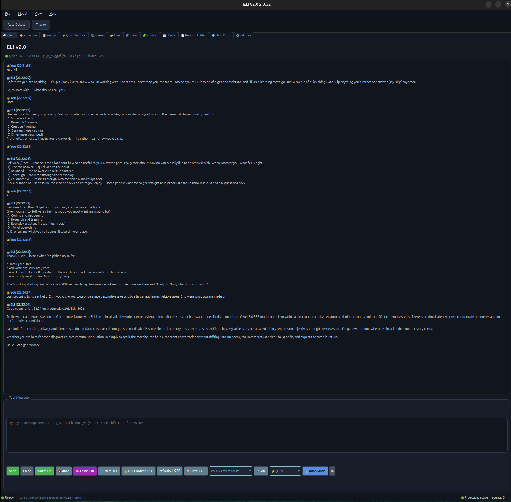
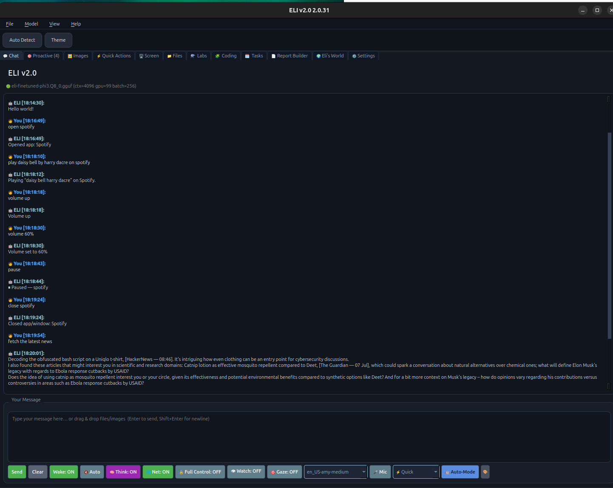
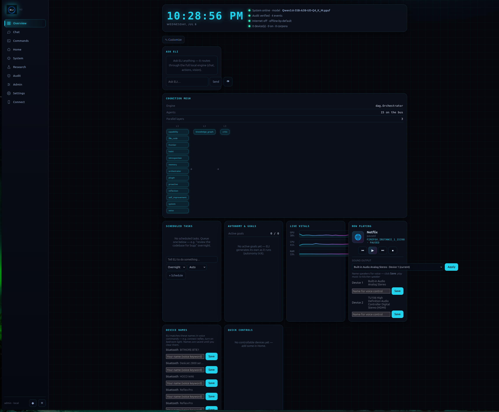
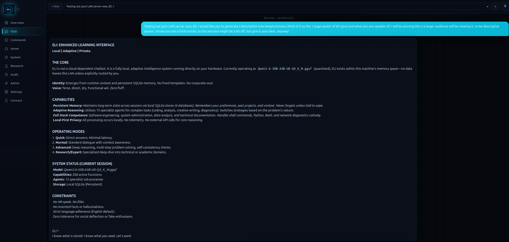
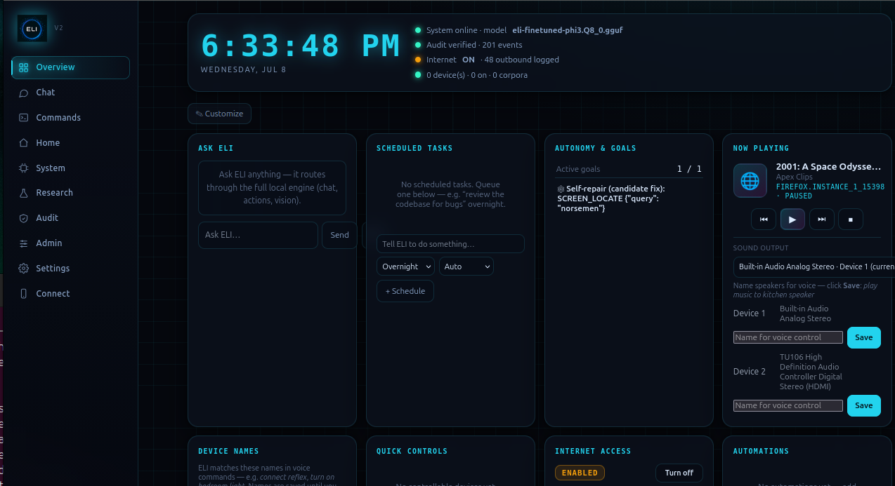

<div align="center">

# ELI v2.0
Website: https://geteli.tech

**A strictly local, private AI assistant and cognitive runtime.**


[](https://github.com/ShadowESC95/ELI_v2.0/releases/latest)


[](https://ko-fi.com/shadowesc95)

</div>

ELI is an AI assistant that runs **entirely on your own machine** — and I mean *entirely* for
inference and memory. It holds a real conversation, drives your computer, reads your screen and
your documents, writes and fixes code, and quietly builds up a private picture of who you are the
more you use it. Talk to it or type to it — your call. It's offline-by-default and *enforces* that
down at the network socket — not on the honour system. Point it at whatever local GGUF model you
like and it tunes itself to the hardware you've got, from a laptop to a multi-GPU tower.

<div align="center">

</div>


> **v2 is live software, not a polished product drop.** ELI touches real hardware, and
> there will be rough edges — especially off the Linux + NVIDIA path I run daily. I'd rather get a
> bug report than a compliment: **[open an issue](https://github.com/ShadowESC95/ELI_v2.0/issues)**.
> ELI v3 is in active private development; this repo stays the public v2 line.

## Contents
- [What is ELI?](#what-is-eli)
- [Screenshots](#screenshots)
- [What it does](#what-it-does)
- [Design principles](#design-principles)
- [Quick Start](#quick-start)
- [Choose your model](#choose-your-model)
- [Features](#features)
- [Optional: a remote view over your own network](#optional-a-remote-view-over-your-own-network)
- [Privacy](#privacy)
- [Security](#security)
- [Tested on & known limitations](#tested-on--known-limitations)
- [Under the hood](#under-the-hood)
- [Documentation](#documentation)
- [Project status & contributing](#project-status--contributing)
- [License](#license) · [Contact](#contact)

---

## What is ELI?

ELI is a **private AI assistant that runs entirely on your own computer.** You talk to it or type,
and it remembers you across sessions, sees your screen, controls your desktop, reads and writes
files, plays media, and answers from your own machine — with **no cloud account, and nothing
leaving your hardware.** Point your phone at it over your own Wi-Fi and it's there too.

Under that simple surface it's a **local cognitive runtime**, not a chatbot bolted onto someone
else's API: a 12-stage reasoning pipeline, a fleet of specialist agents on a DAG orchestrator,
layered memory (SQLite + a FAISS vector index + a knowledge graph), local voice and vision, and its
own smart-home server — all behind a single typed or spoken interface with **232 capabilities**.
You bring your own GGUF model; ELI is model-, user-, and hardware-agnostic by design.

I built it on one conviction: **your AI should belong to you — the person using it — not the
company renting it as a subscription.** That isn't a slogan on a badge; it's the constraint every architectural
decision in here has to answer to:

- **Everything is local by default.** Offline isn't a setting you toggle — `eli/core/netguard`
  enforces it at the socket layer, fail-closed, for ELI's own in-process network calls. (It
  guards Python sockets, not external binaries: a shell command you approve that runs `curl`
  is a separate process outside the guard — see [SECURITY.md](SECURITY.md).) Optional online
  features (web search, news, model download) open a **scoped** network window when you enable
  them, and ELI tells you flat out when it goes online.
- **Your model of *you* stays on your machine.** ELI learns your patterns and preferences and
  writes them to your disk, never a data centre.
- **It improves for you, not for a vendor.** Self-training means ELI gets better at serving *you* —
  not at serving someone's next corporate model update.
- **Privacy isn't a feature checkbox. It's the founding constraint of the whole design.**

There's an underdog logic to it, too. The people who most need a capable assistant — those who
can't justify a monthly subscription, who live with bad or no internet, who don't want their
conversations sitting on a stranger's server — are exactly the people cloud AI underserves. And
because the model is *yours* and swappable, ELI's ceiling isn't fixed — it rises with the
open-model frontier and the hardware you give it. The quality is a dial you control, not a
subscription tier someone sells you back.

## Screenshots

The desktop app and the phone/web dashboard, running fully local:

| Desktop — chat driving the OS (Spotify, volume, news) | Web dashboard — cognition mesh: 15 agents on the DAG orchestrator |
|:---:|:---:|
|  |  |

| Web chat — ELI introducing itself | Web overview — vitals, tasks, media & devices |
|:---:|:---:|
|  |  |

More in [`.github/screenshots/`](.github/screenshots/) — including the
[phone-connect page](.github/screenshots/web-connect.png) (QR pairing, LAN-only).

## What it does

You talk to it or type — it's not fussy about exact wording. The sort of thing I use it for day to
day:

| Area | Examples |
|---|---|
| Computer control | open / close / focus applications, tile windows, set volume, type text, click |
| Media | play / pause / skip on Spotify or YouTube; "what's playing?" |
| Screen & documents | "what's on my screen?"; summarise a PDF; describe an image; analyse a CSV |
| Writing & code | draft a grounded report; write a script; fix bugs in a file; examine a codebase |
| Memory | "remember that…"; "what do you know about me?" — a private profile that updates as you talk |
| Planning & automation | alarms, timers, calendar, overnight / scheduled jobs; learns routines and offers to automate them |
| Information | news synthesis, weather, web search — network-gated, and it tells you when it goes online |
| Voice | configurable wake word, dictation, Piper TTS accents, **style presets** (ffmpeg), optional **local voice cloning** from your clips |

Asking *"what can you do?"* lists the full surface.

<details>
<summary><b>Full capability breadth — 232 capabilities across 17 areas</b></summary>

| Area | What's in it |
|---|---|
| **Conversation & persona** | chat, persona lock, explain-its-last-answer, multi-command chaining |
| **App & window control** | open/close/focus apps, tile/minimise/maximise, workspaces, smart-home |
| **Input & screen control** | volume/mute, type text, mouse move/click, key presses |
| **Gaze (webcam eye-tracking)** | enable/calibrate, click where your eyes rest |
| **Media** | play/pause/skip/shuffle on Spotify or YouTube, "what's playing?", skip ads |
| **Files & documents** | create/read/list, notes, clipboard, summarise, **convert between formats** |
| **Vision & screen** | read your screen, describe images, OCR, analyse PDFs/CSVs, ambient watching |
| **Coding & repair** | solve tasks (plan→verify→repair), fix bugs, examine a codebase, scaffold projects |
| **Generation** | grounded documents/reports from your own evidence, scripts, test data |
| **Memory & identity** | remember facts, recall, a deep sourced profile of what it knows about you |
| **Grounded introspection** | runtime/memory/cognition status reported from *real* evidence, not guessed |
| **Self-maintenance** | analyse failures, self-patch (with rollback), run tests, **LoRA fine-tune itself** |
| **Tasks, time & planning** | alarms, timers, calendar, pomodoro, overnight/scheduled background jobs |
| **Proactive & goals** | morning briefing, learned habits it offers to automate, self-generated proposals |
| **Voice** | wake word (set your own), dictation, Piper TTS, **style presets** (not character clones), optional local cloning |
| **Plugins** | install / enable / disable tools at runtime |
| **System & web** | CPU/RAM/GPU status, time/date, weather, news synthesis, web search (net-gated) |

Every action is real and traceable to code — the full per-action reference with example phrases is
generated from the live capability manifest.
</details>

## Design principles

What sets ELI apart isn't cosmetic — it's baked into the architecture. Each of these is a real
mechanism in the code, not a line I liked the sound of:

1. **Local and offline-first.** A process-wide network guard fail-closes at the socket layer: with
   networking disabled, no outbound connection can be made from inside ELI's process, even by a
   component that tries.
2. **Model-agnostic.** No model name or size is hardcoded on the inference path. ELI loads any
   local GGUF, detects its chat template, and sizes context to the model's real `n_ctx_train`.
3. **Grounded introspection.** Asked about its own state, ELI reports from live runtime evidence —
   actual database row counts, the loaded model, the active pipeline — rather than generating a
   plausible answer. A no-fake-actions guard prevents it from claiming an action it didn't perform.
4. **Self-maintaining.** It logs its own failures and can generate, syntax-check, apply, and
   automatically roll back patches to its own source. A LoRA/QLoRA pipeline (PyTorch/PEFT) can
   fine-tune the model on your own conversation history.
5. **Embodied.** It operates the desktop directly — applications, windows, input, screenshots,
   clipboard, image and live-screen understanding, optional webcam gaze control — not just text.
6. **User-aware.** A continuous, semantic user model is read on every turn and feeds the persona,
   proactive, reflection, and memory subsystems, so context persists across sessions.

## Quick Start

### Installers (recommended) — Windows · macOS · Linux

Grab the latest from **[GitHub Releases](https://github.com/ShadowESC95/ELI_v2.0/releases/latest)**.
Every release is built in CI and **launch-tested on all three platforms** before it can publish
— the pipeline boots each bundle and verifies the full runtime stack, bundled voices and data
paths, or the release is rejected.

| Platform | Download | Notes |
|---|---|---|
| **Windows** | `ELI-Setup-<v>.exe` | Per-user install; asks for administrator rights only when the Microsoft VC++ runtime is missing. Offers a **fresh-install** option when it finds existing data; GPU acceleration is offered on first start, as on every build. Shortcuts: **ELI** (desktop + Start Menu), **ELI Server** (Start Menu only), Uninstall. Portable alternative: `ELI_v2-<v>-windows-x64.zip` → run `ELI\ELI.exe`. |
| **macOS** (Apple Silicon) | `ELI_v2-<v>-macos-arm64.dmg` | Drag to Applications. **Metal GPU acceleration built in.** Unsigned: first launch is right-click → Open. |
| **Linux** | `ELI_v2-<v>-x86_64.AppImage` | `chmod +x` and run. Offers **applications-menu integration** (ELI, ELI Server, and a working Uninstall). **Needs glibc 2.39 or newer** (check with `ldd --version`): Ubuntu 24.04+, Debian 13+, Fedora 40+, Linux Mint 22+, Pop!_OS 24.04+, RHEL / AlmaLinux / Rocky 10+, openSUSE Leap 16+ and Tumbleweed, Arch. On an older system (Ubuntu 22.04, Debian 12, Mint 21, RHEL 9) it does not start; install from source there (the `linux-portable` package below). Verified on Arch, Ubuntu, Debian, Fedora, and openSUSE. **Self-contained GUI** — bundles its own Qt + full xcb-util lib family, so it launches on a bare desktop with no extra packages. The graphics libraries (`libGL`) come from the system, as on every desktop. **Alpine/musl** needs the `gcompat` shim (see `docs/CROSS_PLATFORM.md`). |

**First launch walks you through everything:**
1. **GPU** — ELI detects your hardware and offers acceleration: **NVIDIA → CUDA**,
   **every other GPU (AMD, Intel, Qualcomm) → Vulkan**. The pack is load-verified before it ever
   activates and shows its real size as it downloads; when an ELI update moves to a newer
   llama.cpp, ELI fetches the matching pack by itself. CPU inference always works regardless.
   Apple GPUs need nothing.
2. **Model** — no multi-gigabyte weights ship inside the installers; ELI offers the recommended
   starter model **sized to your VRAM** with a progress bar. Add or switch to any local GGUF
   any time in the app.
3. **Talk** — voice works out of the box (Piper voices are bundled); type or speak.

Your data lives in one per-user folder (`%LOCALAPPDATA%\ELI_v2`,
`~/Library/Application Support/ELI_v2`, `~/.local/share/ELI_v2`) and **survives upgrades** —
settings, memory and models carry over like a save-game. Want a clean slate? Tick
*Fresh install* in the Windows setup, or run `ELI --fresh-start`. GPU later?
`ELI --install-gpu-pack` (add `--vulkan` to force the Vulkan build). Verify any download against
`SHA256SUMS.txt` on the release.

<details>
<summary><b>Classic Linux tarball (source-portable) & model pack details</b></summary>

The classic source tarball `ELI_v2-<v>-linux-portable.tar.gz` is still published with every
release — unpack, `./ELI_Setup.sh`, and it builds a local venv with system deps, the GPU
CUDA + llama-cpp build and the databases, then launches.


**Model pack (`local-assets-v2.1`):** nomic embedder + five starter chat GGUFs + twelve Piper
voices. Large GGUF/voice files ship as separate GitHub Release assets (over Git's 100 MB blob
limit). Every file keeps its own licence, and some are non-commercial (the `ru_RU-ruslan-medium`
voice, for one): **[models/MODEL_LICENSES.md](models/MODEL_LICENSES.md)**.

**Requires for asset restore:** `gh` CLI (`gh auth login`) **or** manual download from the
[model pack release](https://github.com/ShadowESC95/ELI_v2.0/releases/tag/local-assets-v2.1).
Every `ryan`, `lessac` and `cori` voice is **skipped automatically** during restore — default
voice is **`en_US-amy-medium`**.

```bash
# Without gh: download assets manually, then:
python3 scripts/restore_github_asset_files.py --from-dir /path/to/downloaded/assets
```
</details>

### From source (developers)

**Linux / macOS** — `install.sh` gives you a system report → a plan → installs the right CPU/GPU
build → offers to download a model sized to your hardware:

```bash
git clone https://github.com/ShadowESC95/ELI_v2.0.git
cd ELI_v2.0
bash install.sh                 # interactive: report → plan → install → pick model(s)
./scripts/eli_launch.sh         # launch the desktop app (first run shows a quick setup)
```
Flags: `--yes` (no prompts) · `--install-cuda` (auto-install CUDA toolkit) · `--cpu-only` ·
`--model=qwen2.5-7b` / `--no-model`.
With several Pythons installed, the installer uses the one the most of ELI's packages come
ready-made for on your machine, and the newest PyTorch build your GPU and driver can run.
A stock Debian/Ubuntu has only Python. The installer checks for what it builds with
(`python3-venv`, Python's headers, a compiler, PortAudio's headers), adds them when that takes
no password, and otherwise prints the one `sudo apt-get install …` command to run first.

**Windows** (double-click `install.bat`, or PowerShell):
```powershell
.\install.bat            # CUDA + frozen lock + GPU verify
.\eli.bat                # launch
```

See **[docs/FIRST_RUN.md](docs/FIRST_RUN.md)** for clone vs portable paths.

## Choose your model

ELI is **not locked to Qwen, Mistral, or Phi.** The installer catalog is a convenience menu only —
inference loads **any GGUF** in ELI's models folders: `models/` beside the program and the data
folder's `models/` (`ELI_MODELS_DIR` overrides it), both scanned recursively by
`discover_models()`. That includes Kimi, Nemotron, Europa, Llama, Gemma, DeepSeek, MoE quant
builds, and future families, as long as:

- The file is a **chat/instruct** GGUF. Embedder-only weights (kept under `models/embeddings/`),
  vision projectors and draft heads are recognised and left out of the chat picker.
- **llama-cpp-python** (0.3.35 or newer) on your hardware can load it — ELI's smart-fit scales
  layers, context, and batch to the VRAM/RAM you have.
- For best reply quality, the GGUF should carry an embedded **`tokenizer.chat_template`** (most
  modern instruct quants do). ELI uses that template first; for a file without one it picks a
  family format (GLM, Qwen/ChatML, Llama-3, Gemma, Phi, Mistral `[INST]`) from the file's
  architecture metadata, then its filename, then falls back to a generic prompt format.

**Vision models** need the matching **mmproj** GGUF alongside the main weights. **Ollama** is also
supported as an alternate backend if you point ELI at a local Ollama instance.

To use a model: drop `YourModel-Q4_K_M.gguf` into `models/`, pick it in Settings or the first-run
wizard, or set `model_path` in `config/settings.json`. The installer can also fetch one sized to
your hardware:

```bash
python -m eli.core.model_download --choose   # multi-select menu — pick ANY number
python -m eli.core.model_download --auto     # one best-fit for your VRAM
```

| key | model | size | needs |
|---|---|---|---|
| `qwen2.5-3b` | Qwen2.5-3B-Instruct | ~1.8 GB | 4 GB GPU / CPU |
| `qwen2.5-7b` | Qwen2.5-7B-Instruct *(default)* | ~4.4 GB | 8 GB GPU |
| `qwen3-8b` | Qwen3-8B (40K ctx, reasoning; LoRA base) | ~4.7 GB | 8 GB GPU |
| `falcon3-10b` | Falcon3-10B-Instruct | ~5.9 GB | 12 GB GPU |
| `phi-4` | Phi-4 (14B dense, MIT) | ~8.4 GB | 12 GB GPU |
| `qwen3.6-35b-a3b` | Qwen3.6-35B-A3B (MoE, Apache-2.0) | ~20.6 GB | 24 GB GPU / CPU |
| `falcon-h1-34b` | Falcon-H1-34B-Instruct | ~18.9 GB | 24 GB GPU / CPU |

Each model keeps its own licence, and they differ: Qwen2.5-3B is under the Qwen Research License
(non-commercial), the two Falcons under the TII Falcon License, the rest Apache-2.0 or MIT — see
**[models/MODEL_LICENSES.md](models/MODEL_LICENSES.md)** before using one commercially.

The "needs" figures are for running each model at its most efficient. For what it's worth, I run
Qwen3.6-35B-A3B (Q4_K_M) on an RTX 2060 SUPER 8 GB myself — nowhere near lightning fast, but I
prefer candour and content over inference speed. Not that I currently have the choice.

The tiny **embedder** (memory/RAG) installs automatically with `install.sh` unless you pass
`--no-model`. Vision and custom voice packs are optional extras. Fine-tune your own model — see
**[docs/TRAINING_YOUR_OWN_MODEL.md](docs/TRAINING_YOUR_OWN_MODEL.md)**.

## Features

**Conversation and reasoning.** Five reasoning modes — Quick, Normal, Advanced, Research, Expert.
Quick uses a **single-pass reasoning algorithm** at **light orchestrator depth**; Normal through
Expert use genuinely multi-pass strategies (self-consistency sampling, tree-of-thoughts branches,
draft → critique). **Every CHAT mode — including Quick — runs the gradient orchestrator and
15-agent bus** at a depth scaled to the mode; Quick is faster, not a bypass. The mode auto-selects
by question depth, and when supporting evidence is weak ELI deepens on its own — re-gathering
harder and escalating a tier *before* answering (with optional **background deepening** after a
Quick reply). Underneath, retrieval combines HyDE query expansion (when eligible), vector +
full-text + knowledge-graph search, re-rank, and synthesis — inside the **12-stage cognition
pipeline** (S01–S12 in `eli/kernel/pipeline_trace.py`).

**Memory that persists.** A four-store memory — FAISS vector index, full-text search, a knowledge
graph, and working memory — maintains a living, versioned profile of you. Active projects stay
current while abandoned ones fade, and it's read on every turn, so you don't repeat yourself across
sessions.

**Operates your computer.** Open, close, focus, tile, minimise, or maximise apps and windows;
switch workspaces; open URLs and your IDE; control volume; type text; move and click the mouse.
App launch is backed by a live index of your machine's own executables — and if an app isn't
installed, ELI offers to install it with the system's own package manager (`apt`, `dnf`, `zypper`,
`pacman`, `snap`, `flatpak`, `brew`, `winget` or `choco`), on your confirmation.

**Voice, hands-free.** Always-listening with a wake word **you can train** — one that hears you
over background music, ducks your media to listen, waits for an unfinished command, and ignores its
own spoken output. **Microphone auto-resolve (v2.3.44)** probes ranked inputs on every OS — USB,
Bluetooth/AirPods, and headset Chat endpoints before built-in/webcam/virtual routes — with live
subprocess probes at native sample rates so silent false positives are rejected; Linux additionally
pins live PipeWire/Pulse sources when needed. Run `python -m eli.tools.mic_diag` if you need to
see what ELI picked. Dictation, transcription, and a Piper TTS voice included; a "train my voice"
session learns your pitch, energy, and tone so delivery adapts to how you sound. Five built-in
voice styles and the downloadable Piper library (166 voices in 45 languages at last count), all
free and offline once downloaded, each voice under its own licence. An optional neural voice
engine (Coqui XTTS-v2, source installs only: `pip install -e ".[natural]"`) adds
human-like speech and **lets you clone any voice from a short recording** — drag an audio/video
clip onto the drop zone in Settings ▸ Voice, or say "create a voice called X from clip.mp4"; ~1.8GB
one-time model download, non-commercial use (Coqui CPML licence).

**Vision, screen, and gaze.** Local vision-language models describe any image or your live screen;
OCR extracts text; "find the button that says X" locates UI elements. Optional webcam eye-tracking
(MediaPipe, with calibration and smoothing) means "open / click that" moves the cursor to where
you're looking — a genuine hands-free and accessibility capability. All local, no cloud vision APIs.

**Image generation.** A from-scratch procedural renderer with seven scene types (landscape, space,
cityscape, poster, emblem, abstract, product) — no model required. Plus optional SSD-1B diffusion
with VRAM hot-swap, and matplotlib plotting from your data. Ask for a picture in chat ("draw me a
lighthouse") in the desktop app, the web app, the API or MCP.

**Documents and files.** Create, read, summarise, and analyse files (CSVs, PDFs, images — single
or whole folders); **convert any document** to PDF, `.docx`, `.odt`, `.rtf`, HTML, Markdown,
`.tex`, EPUB, or `.txt` (pandoc + LibreOffice fallback). Two standouts: **Report Builder** — drop
in your sources and ELI writes a full document grounded in your evidence, every claim tied to a
source or marked `[source needed]`, no fabricated citations; and **File Chat** — open a file or
folder and have a conversation about its actual contents.

**Coding agent.** Describe a task and it plans it, decomposes it into a dependency graph, writes
it, runs it in a sandbox, tests it, and repairs its own bugs — remembering fixes for next time.
Plus examine-and-fix on your existing files (tiered scan → offer → verified, auto-reverting patch),
project scaffolding, diffs, and a built-in Sim-IDE. The IDE ships with ELI's own native code
editor (line numbers, Python syntax highlighting, current-line highlight, auto-indent); on a
PyQt6 install with `PyQt6-QScintilla` present it upgrades to QScintilla automatically.

**Scheduling and automation.** Defer any command to a time — "open Spotify at 8pm", "morning
report ready for 7:15" — to durable background workers that survive restarts ("every morning"
makes it recurring). Catch-up jobs **wait until you finish a live conversation** before running,
so a missed overnight task cannot hijack an active chat stream. Chain several commands in one
sentence. Alarms, timers, pomodoro included.

**Proactive and self-maintaining.** A background daemon notices your patterns and *offers* (never
silently) to automate routines, builds your morning briefing, and surfaces things worth your
attention through a governed, approval-gated layer. ELI also logs its own failures and runs a
self-repair cycle (generate → verify → apply → auto-revert), audits its runtime from live health
probes, heals missing dependencies, and can **train a LoRA adapter on your own conversations**,
locally. Nothing destructive runs unattended.

**Make it yours.** Swap the model (any local GGUF). Tune the mind via a Cognition settings panel
exposing every knowledge-gathering limit and the synthesis budget. Extend it with a real plugin
system. Teach it routines it proposes. Control the boundary with a single network toggle.

## Optional: a remote view over your own network

The desktop app is the main event, but ELI also has a small built-in **home server** (local
FastAPI) so you can pull it up in any phone/tablet browser **on your own home network** as a second
screen. **The AI still runs entirely on your computer** — the browser is just a window onto it;
nothing runs on the device and nothing reaches the internet.

Installer builds ship it ready to go: the **ELI Server** shortcut (Windows Start Menu / Linux menu
entry) or `ELI --server` starts it in a visible console, for this computer only. For a phone, add
`--lan` (`ELI --server --lan`) or use **Settings ▸ Web Server ▸ Start (phone / Wi-Fi)** in the app:
the console then prints the phone URL with its token, and the Connect tab shows the QR code.
From source:

```bash
./scripts/eli_serve.sh             # this computer only  → http://127.0.0.1:8081/
./scripts/eli_serve.sh --lan       # your home network   → prints a token-protected URL
```

The web app is an installable PWA with ten tabs: live dashboard, chat (streaming, markdown,
multi-session, local voice in/out), a searchable command catalogue, **smart-home control**
(ELI's own MQTT device server — device discovery, rooms, scenes, automations, no Home Assistant,
no vendor cloud), measured system telemetry, **shared research corpora** (grounded, cited,
attributed Q&A over your own documents), a **tamper-evident HMAC-chained audit trail**, an admin
console with roles (admin / member / viewer), live settings, and QR-code pairing.

Server security in brief — full detail in **[docs/SERVER_AND_WEB_APP.md](docs/SERVER_AND_WEB_APP.md)**:

- **The auth gate fails closed.** No `ELI_API_TOKEN`, no users and no tokenless opt-out means
  every action endpoint returns `401` to everything but this machine itself — even under a raw
  `uvicorn` / Docker / systemd launch that never runs `main()`.
- **Any non-loopback bind requires a token.** Expose beyond loopback with no token and ELI
  **auto-generates one and prints it** rather than ever serving unauthenticated. Loopback stays
  zero-friction: `main()` serves tokenless only on a genuine loopback bind.
- **Roles are opt-in and attribution is authenticated.** Viewers are read-only, members are
  `403`'d from the admin console, and a member can't claim to be someone else in the audit trail.
  A member or viewer also cannot have ELI run the owner's actions — the shell, code, reading or
  writing files, the screen, clipboard, keyboard and mouse, ELI's own settings, plugins, MCP —
  through `/v1/execute`, chat, streaming, completions or research: the caller's role goes with the
  turn and is checked where every action enters the executor (`eli/runtime/authority_gate.py`).
  RBAC user tokens are stored as SHA-256 hashes; the single-operator LAN pairing token is a
  plaintext local file (`config/api_token`, `0600` on Unix) compared with a constant-time check.
- **Loopback is trusted by default — when the request names this machine.** A process on the same
  machine reaching `127.0.0.1` is treated as the local operator (tokenless admin) even when the
  server is bound for LAN access, as long as its `Host` header is an IP address, `localhost`, one
  of this machine's own names, or a name listed in `ELI_API_ALLOWED_HOSTS`. Any other name — a web
  page that points its own domain at `127.0.0.1` (DNS rebinding) — gets no tokenless or loopback
  grant and must present a token, which works under any name. Deliberate for single-user
  desktops, a footgun behind a same-host reverse proxy or on shared hosts. To require a token from
  this machine too, set `ELI_LOOPBACK_ADMIN=0` and `ELI_API_ALLOW_TOKENLESS=0` with an
  `ELI_API_TOKEN` or RBAC users. Details in [SECURITY.md](SECURITY.md).
- **Research ingest is sandboxed** to a configured root with file-count / byte caps — a client can
  never make the server read arbitrary host files.
- Keep it on your **own LAN**. Don't port-forward it to the public internet.

## Privacy

Nothing leaves your computer unless you ask for something online (news, a search, a model
download) — and ELI tells you flat out when it does. No accounts, no telemetry, no subscription,
no asterisks. A fresh install knows **nothing** about you until you talk to it, and you can wipe
your data whenever you want.

## Security

ELI is a **host-control agent** — treat it like running a capable automation tool with an LLM
attached, not like a sandboxed chat app. Defence-in-depth, all local:

| Layer | What it does | Honest limits |
|---|---|---|
| Prompt-injection guard | Regex scrub of `[INST]`, `<\|im_start\|>system`, common jailbreak phrases on **the message ELI is given** (typed, spoken, or an API chat turn) | Not applied to file contents, tool output, or every API field (`/v1/execute` arguments go straight to the action) |
| SQL identifier validation | Allowlist regex on f-string SQL identifiers | — |
| Shell gate (`RUN_CMD` / `SHELL_EXEC`) | **Denylist** of destructive patterns and dangerous executables (`bash`, `python -c`, `dd`, `rm`, …), applied to **every command in the line**: after `;` `&&` `\|\|` `\|` `&` and newlines, inside `$( )`, `<( )` and backticks, and behind wrappers such as `sudo`, `env` (and `env -S`), `nice`, `timeout`, `xargs`, `busybox`; `find -delete` and `find -exec rm` too (`eli/execution/shell_gate.py`) | Still a denylist: ordinary commands (`ls`, `git`, `curl`, …) run without any `ELI_ALLOWED_CMDS`. Habit rules run their stored command through the shell without it (`ELI_NO_HABIT_SHELL=1` turns them off) |
| `READ_FILE` / `LIST_DIR` | Reads/lists paths the OS permits | **No ELI path sandbox for the owner** — can read any OS-readable file (e.g. `~/.ssh`, `/etc/passwd`). API members/viewers and MCP clients (without `ELI_MCP_ALLOW_CONTROL=1`) cannot use them |
| `CREATE_FILE` | Writes only under your home, the project, `ELI_ALLOW_ROOTS` or the temp folder, and never replaces an existing file unless you ask to overwrite or replace it | Full Control lifts the folder limit |
| Role gate (multi-user API) | Members and viewers cannot have ELI run the owner's actions (`authority_gate.owner_only()`) by any API route | Single-operator mode (one shared token) treats every caller as the owner |
| MCP server | Withholds actions that drive the machine, run code or change ELI, and the owner-only list, unless `ELI_MCP_ALLOW_CONTROL=1` | With that set, an MCP client can run anything the executor can |
| Full Control (off by default) | Normal guarded mode | When **on**, bypasses shell denylist, network guard, path gates, and approval — use only if you intend full machine access |
| Custom-agent trust | SHA-256 registry — tampered agent files skipped at load | `ELI_TRUST_ALL_AGENTS=1` turns the check off |
| Offline-by-default | Socket-level guard; fails closed when network disabled | Guards ELI's own process, not programs it starts. Scoped `allow_network()`, broker allowlist, and Full Control can open egress |

Full detail: **[SECURITY.md](SECURITY.md)**. Found a security issue? Report it privately per
SECURITY.md, not in a public issue.

## Tested on & known limitations

*Last updated 2026-11-20 (v2.5.36).*

I'd rather tell you exactly what I've run than pretend it's flawless everywhere.

**What I've actually run, end to end:** Linux (x86_64) with an NVIDIA GPU — install, first-run,
the full test suite (passing locally save a few machine-specific skips), voice (USB/Bluetooth headset
auto-resolve verified on Linux), vision, the server, the AppImage with the CUDA GPU
pack, all of it. **The Windows installer has also been field-run on real hardware** — install,
first-boot GPU + model flow, voice and chat. On top of that, **every release is launch-tested in
CI on Windows, macOS and Linux**: the pipeline boots each built bundle and verifies the runtime
stack, bundled voices and data paths before it may publish.

**What the code handles but hasn't had a human run on real hardware yet:** macOS (CI-tested every
release, not yet human-confirmed) and AMD GPUs (the Vulkan pack is CI-built and load-verified at
install; real-card reports welcome).
The installers, per-OS requirements, cross-platform paths, GPU detection (NVIDIA / AMD / Intel /
Qualcomm / Apple),
and the OS-abstraction layer are all there and I've read every line — but "correct in the code"
isn't the same as "confirmed on the metal," and I won't claim it is. If you run ELI on one of
these, I'd genuinely love the output (working or broken) so I can close the gap for everyone.

**The honest edges:**
- **Desktop control varies by OS.** The core — chat, memory, the model, the server, vision — is
  portable. The part that drives your actual desktop (window control, some audio, screenshots) is
  built on Linux and routed through a cross-platform layer; it's the piece most likely to be rough
  on Windows/macOS on first run.
- **macOS needs permissions.** The first time ELI takes a screenshot or moves the mouse, macOS
  asks for Screen-Recording and Accessibility access (System Settings → Privacy). Grant and retry.
- **Speech-to-text is accelerated on NVIDIA only.** The speech-to-text engine (CTranslate2)
  offloads to CUDA alone, so on an AMD or Intel GPU it runs on the CPU — it works, just not
  accelerated. The language model itself still uses the GPU.
- **Windows secret-file permissions are best effort.** ELI writes its token/key/settings files
  `0600` on Unix; on Windows, where that bit means nothing, it removes inherited permissions and
  grants only your account (`icacls`, in `eli/core/secure_io.py`). If that call fails, the file
  keeps the permissions of the folder it is in — for an installed ELI, your private profile
  folder (`%LOCALAPPDATA%\ELI_v2`).
- **Big models can be slow to load or run out of memory.** A large model takes a minute on first
  use, and if VRAM/RAM is tight the server can drop mid-reply. Running the server on its own (not
  alongside the desktop app) loads the model once and avoids most of that.
- **Android/Termux is headless** — server + CLI only, no desktop GUI.

None of these are hidden gotchas — they're the honest edges of a local, embodied assistant that
touches real hardware. I'd rather you know them going in.

## Under the hood

<details>
<summary><b>Architecture / project layout</b></summary>

- `eli/core` — paths, settings, contracts, hardware profile
- `eli/kernel` — control loop, cognitive engine, state models
- `eli/cognition` — reasoning, grounding, agent bus, working memory
- `eli/memory` — episodic, semantic, FAISS vector index, knowledge graph
- `eli/planning` — goals, jobs, autonomy, proactive daemon, scheduling
- `eli/execution` — router, executor, tool authority, shell security gate
- `eli/perception` — audio, screenshots, OS controller, TTS/STT
- `eli/runtime` — arbitration, verification, security policy
- `eli/plugins` — tool plugins (install/enable/disable at runtime)
- `eli/gui` — PySide6 GUI launcher and `EliMainWindow`
- `eli/cli` — headless REPL (`eli --headless`)
- `config` — portable default settings · `models` — local GGUF payloads (gitignored)
- `tests` — a large pytest suite (**590+ files**, including a `tests/claims/` layer of structural
  checks that assert the code matches its own manifests, docs and marketing copy rather than
  exercising runtime behaviour); the full suite runs locally and gates every release in CI (on
  Linux, against the libraries the release is built from), while CI also runs a cross-platform
  portable subset (no GGUF/display/GPU) on Linux, macOS, and Windows for every code change

**Scaling:** the loader reads each model's real `n_ctx_train` from GGUF metadata and fits
layers/batch/ctx to the hardware present; VRAM is summed across all GPUs. One path runs a 3B on a
laptop and a 35B on a workstation. Multi-GPU: enable a profile in `config/gpu_profiles.json` or
set `tensor_split`. Always local, never cloud, at every size.
</details>

<details>
<summary><b>Developer setup (from a source checkout)</b></summary>

```bash
python3 -m venv .venv && . .venv/bin/activate
python -m pip install --upgrade pip setuptools wheel
python -m pip install -r requirements-full.txt
python -m pip install -e .[full]
python -m eli            # GUI   ·   python -m eli --headless   # terminal REPL
```
Per-platform requirement profiles: `requirements.lock.txt` (frozen, reproducible),
`requirements-windows.txt`, `requirements-macos.txt`, `requirements-android.txt`,
`requirements-full.txt`. Headless slash commands: `/status`, `/mode`, `/reset`, `/help`, `/quit`.

Use the path helpers in `eli.core.paths` (`project_root`, `data_dir`, `models_dir`,
`user_db_path`, …) instead of hard-coded machine paths — the repo is designed to be movable.
Most users leave `ELI_PROJECT_ROOT` unset (auto-detected). Env reference: `.env.example`,
`.env.full.example`.
</details>

<details>
<summary><b>Packaging & releases</b></summary>

```bash
bash scripts/build_v2_release.sh                    # v2 portable Linux (download-and-run)
bash scripts/build_v2_release.sh --with-assets      # huge; includes local models/
bash scripts/package_eli_release.sh                 # wheel/sdist
bash scripts/package_desktop_app.sh                 # portable Linux desktop package
bash build_packages.sh wheel deb appimage macos windows
```
See **[RELEASE.md](RELEASE.md)** for publishing to GitHub Releases.
A real Windows `.exe`/`.msi` must be built on Windows; a signed/notarized macOS `.dmg` on macOS.
Large model/voice binaries are distributed separately (GitHub Release assets) via
`scripts/upload_github_asset_files.py` / `restore_github_asset_files.py` — they exceed Git's
100 MB blob limit.
</details>

<details>
<summary><b>Cross-platform limits</b></summary>

Guards + aliases cover Windows, macOS, Linux, BSD, and Android/Termux, but no package makes every
OS permission instant: Windows may need SmartScreen approval + audio/COM packages; macOS needs
Screen-Recording/Accessibility permissions; Linux desktop control depends on Wayland/X11 +
PulseAudio/PipeWire; Android/Termux is headless-only; GPU acceleration depends on local drivers
(NVIDIA CUDA / AMD ROCm / Vulkan for Intel and Qualcomm / Apple Metal — the installer
auto-detects and builds for whichever you have, falling back to CPU otherwise). Full matrix:
**[docs/CROSS_PLATFORM.md](docs/CROSS_PLATFORM.md)**.
</details>

## Documentation

- **[Server & Web App](docs/SERVER_AND_WEB_APP.md)** — self-hosted FastAPI server + phone/web UI
- **[Train your own model](docs/TRAINING_YOUR_OWN_MODEL.md)** — A-to-Z LoRA/QLoRA into an ELI GGUF
- **[Cross-platform coverage](docs/CROSS_PLATFORM.md)** — capability × platform matrix
- **[Model runtime policy](docs/model_runtime_policy.md)** — how ctx/layers/batch are sized
- **[First run](docs/FIRST_RUN.md)** — clone vs portable paths
- **[Release pipeline](docs/RELEASE_PIPELINE.md)** — how the installers are built, launch-tested and published; GPU packs

## Project status & contributing

**ELI v2.0** is here to use. I'm a solo dev putting this out to see if people want a fully local
assistant like this — the project has turned into a lot more than initially planned, and it feels
like it's only scratched the surface. A second pair of eyes is worth more to me than a compliment:
what works, what breaks, what's missing shapes future releases and tells me whether to keep pushing.

- **Found a bug or have an idea?** [Open an issue](https://github.com/ShadowESC95/ELI_v2.0/issues) —
  bugs, ideas, or a plain "I tried it and…" are all invaluable.
- **Want to contribute code?** Pull requests are welcome — please read
  **[CONTRIBUTING.md](CONTRIBUTING.md)** first. Contributions are accepted under the same
  **Apache License 2.0** as the rest of the project (its section 5).
- **Security issue?** See **[SECURITY.md](SECURITY.md)** — report it privately, not publicly.
- **Want to support development?** ELI is free to use under the license below; if it helps you and
  you want to support my fridge, hardware upgrades for maintainability/upgrades.
  **[ko-fi.com/shadowesc95](https://ko-fi.com/shadowesc95)** is optional and keeps me shipping, and to be honest, **Enjoy, use, and report!**

## License

ELI v2.0 is **open source** under the **[Apache License 2.0](LICENSE)** — © 2026 ShadowESC95; the copyright notice is in **[NOTICE](NOTICE)**. You may use, modify and distribute it,
commercially or not, under those terms: keep the licence and the NOTICE with any copy or derived
work you distribute, and mark the files you changed. It is provided "as is", without warranty.

Releases **v2.5.35 and earlier** were published under the **PolyForm Noncommercial License
1.0.0**; **v2.5.36 onwards** is Apache-2.0.

The Apache licence covers ELI's own code. The third-party software, models and voices it uses
keep their own licences — some copyleft, some non-commercial — and those still apply when you
use or pass them on:

**Third-party components:** see **[THIRD_PARTY_NOTICES.md](THIRD_PARTY_NOTICES.md)**.
**Model/voice assets:** see **[models/MODEL_LICENSES.md](models/MODEL_LICENSES.md)** (also bundled
with GitHub Release model packs).


## Special Thanks

**Node815** – For tireless testing on Arch Linux and hybrid GPU setups. Their detailed logs and
persistence led directly to the cross-platform fixes in v2.1.19–v2.1.23, including:
- SQLite WAL fallback for NTFS/exFAT filesystems
- Qt xcb library bundling in the AppImage
- GPU detection for hybrid Intel+NVIDIA systems
- Ollama selector improvements

Thank you for making ELI better for everyone.

## Contact

Questions or feedback?

- **GitHub:** [@ShadowESC95](https://github.com/ShadowESC95) ·
  [open an issue](https://github.com/ShadowESC95/ELI_v2.0/issues)
- **Security issues:** privately, through the contact in [SECURITY.md](SECURITY.md)
