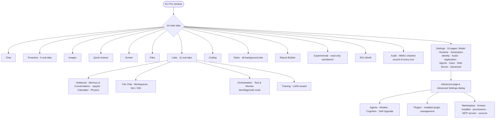

# ELI GUI

> **Updated for v2.5.36.** The Ollama model selector works on packaged builds because
> `eli/gui/qt_compat.py` exports `QDialogButtonBox`.

`eli/gui/` — 26.7k LOC, 23 modules (8 top-level; 5 in `panels/`, 5 in `tabs/`, 2 in `docks/`,
3 in `widgets/`) plus their package `__init__` files. A full native PySide6/PyQt desktop app
(with a Qt-binding compat shim), plus a first-boot launcher and a large scientific
"Labs" workspace.

## Tab map (current — 14 main tabs)

The window builds them in this order (`EliMainWindow.init_ui`); tabs can be dragged into
another order.

Proactive's sub-tabs are Suggestions, Summaries, Insights, Habits, Self-Improve and Memory.

### Marketplace and training additions

| Surface | Where | What it is |
|---|---|---|
| 🎓 **Training** | Labs sub-tab | four-step LoRA wizard: Hardware → Target → Data → Train |
| 🛒 **Marketplace** | Advanced Settings dialog tab (Settings ▸ Advanced) | community plugins: browse, verify, scan, install, permissions, sources |
| **Permission dialog** | anywhere | Android-style consent: Allow once · Always allow · Not now · Never allow |
| 🎯 **Eval board** / ⚖️ **Eval + judge** | Labs ▸ Test & Review | behaviour regression board, run in-process |

## Files

| File | LOC | Role |
|---|---|---|
| `eli_pro_audio_gui_v2_0.py` | 12.5k | the main window + most app logic (god-file) |
| `labs_tab.py` | 5.7k | scientific workspace tab |
| `panels/startup.py` | 2204 | guided first-boot: hardware, model pick or download, tuning |
| `tabs/marketplace_tab.py` | 991 | Advanced Settings ▸ Marketplace — browse/installed/permissions/MCP servers/sources |
| `tabs/training_tab.py` | 841 | Labs ▸ Training — the LoRA wizard |
| `panels/settings.py` | 818 | the Advanced Settings dialog: Agents, Models, Cognition, Plugins, Marketplace, Self-Upgrade |
| `widgets/ollama_model_selector.py` | 494 | optional Ollama model picker |
| `panels/agent_wizard.py` | 415 | agent edit dialog + the `AgentSpec` authoring dialog |
| `app.py` | 325 | launcher / entry `main()` / terminal model setup |
| `tabs/tasks_tab.py` | 307 | Tasks — background jobs and scheduled or overnight tasks |
| `docks/operator_console_dock.py` | 303 | operator console dock |
| `widgets/voice_downloader.py` | 282 | Piper voice library browser |
| `panels/permission_dialog.py` | 232 | plugin consent dialog + thread-marshalling bridge |
| `widgets/eli_face.py` | 230 | ELI's animated 2D face, driven by the tone adaptor's emotion |
| `code_editor.py` | 220 | native code editor (line numbers, current-line highlight, Python highlighting, auto-indent) |
| `coding_tab.py` | 178 | Coding — a task for the coding agent, run as a background job |
| `tabs/experimental_tab.py`, `qt_compat.py`, `branding.py`, `off_thread.py`, `panels/_qt.py`, `docks/proactive_dock.py`, `tabs/eli_world_tab.py` | small | tabs/docks + Qt compat, icons, off-thread helper |

## Launcher (`app.py`)

The entry path for the `eli`/`eli-gui` console scripts. `main()` pins this install's root
(`ELI_PROJECT_ROOT`, from the venv running it) and its data and config folders where none is
set or the one set belongs to another ELI install (`runtime_settings.inherited_from_another_install`),
and its models folder where none is set, so it never writes into another checkout; a data or
config folder the user set elsewhere is kept. It runs the first-boot bootstrap
(`init_data.bootstrap_once`), stops with a plain message when the data folder cannot be
written (`init_data.store_blocker`), and activates the bundled GPU pack when there is one.
With the startup model picker
enabled (the default) it hands over to `eli_pro_audio_gui_v2_0.main()`, whose startup dialog
owns model choice, tuning and loading. `--setup` takes the terminal path instead:
`_pick_model` over `_setup_models` (the chat models `hardware_profile.discover_models` finds in
the models folder, `ELI_MODELS_DIR` included, and the program's own `models/`, embedders, vision
projectors and draft heads left out, plus the saved model wherever it is) and `_confirm_params`,
with the values from `_auto_tune(model_path)`, which is
the plan `gguf_inference.load_model` would use on this machine now (`eli/core/load_plan.py`,
sized to each card's **free** memory — the display server takes VRAM before ELI launches,
so free ≠ total). A returning launch with the picker turned off loads the saved model with
the saved values without asking. Either terminal path then loads the model, warms the
embedder in the background and opens the window.

## Main window (`eli_pro_audio_gui_v2_0.py`)

A 12.5k-line module holding the window (`EliMainWindow`) **and** a stack of embedded classes
that are really application logic, not just UI:
- `CentralMemoryAdapter` — bridges the GUI to the memory subsystem.
- `LocalModelManager` (line 738) — discover/load/swap local GGUF models. It builds the
  vector store (and with it the embedder) before the model, so the load plan sees the
  memory the embedder takes.
- `OllamaModelManager` (line 914) — optional Ollama integration (legacy/optional;
  ELI's stance is 100% local GGUF, so this is a secondary path).
- `ExecutorBridge` (line 1043) — routes GUI actions into the executor/engine.
- `_GUIEngineAdapter` — engine façade for the UI.
- UI widgets: `_QABoard` (quick-action card board), `_MiniTelemetryGraph` (live
  telemetry), `_ZoomableSettingsView`, `_ZoomableImagePreview`, `_FlowLayout`,
  `_CapabilityList`.
- `pyqtSignal`/`Slot` aliased through `qt_compat.py` so it runs on PyQt **or**
  PySide.

Threading: every long-running worker in this file marshals results back to
the GUI thread via a class-level `pyqtSignal` connected with an explicit
`Qt.ConnectionType.QueuedConnection` — the safe cross-thread pattern (same
one Training already used correctly, see below). Two screen-control call
sites (OCR results, "ask ELI" results) used `QTimer.singleShot(0, ...)`
called *from* the worker thread instead, which has no guaranteed event loop —
fixed to use the same signal pattern as the neighbouring capture handler.

### The status-bar confidence/grounding badge

`_update_confidence_meta_label()` reads `CognitiveEngine._last_request_meta`, refreshed once
per turn via the `_conf_meta_update_sig` signal fired at the end of `send_message()`'s worker.
Two gaps let it show stale or wrong numbers:

- The GUI always calls `process(..., stream=True)`, regardless of reasoning mode. A
  chain-of-thought/tree-of-thoughts/constitutional-AI/self-consistency turn runs its passes as
  discrete non-streaming GGUF calls, so `_run_internal_orchestrator` returns a plain dict, not a
  generator — `stream=True` with a non-generator result matched neither of the function's two
  meta-publish branches, so `_publish_orchestrator_turn_meta` was never called and the badge kept
  whatever an earlier, unrelated turn had left in it (observed: a 0.94-scoring CoT reply left the
  badge reading "0.00 (phatic_light)" from a prior greeting). Fixed by unifying the branch
  condition around whether the result actually is a generator, not just whether streaming was
  requested.
- Separately, the streaming/phatic meta-publish block computed the turn's real Stage-12 response
  score but then discarded it, publishing the agent-bus aggregate confidence instead — which is
  genuinely 0.0 on a phatic turn, since the agent bus is deliberately skipped for those. Fixed by
  publishing the Stage-12 score.

See `tests/test_confidence_badge_reflects_the_real_turn.py`.

## Labs workspace (`labs_tab.py`)

A 5.7k-line "scientific workspace" tab with **11 sub-tabs**: Notebook, Memory &
Conversations, Jupyter, Calculator, Physics constants, File Chat, Workspaces,
Sim/IDE, **Orchestration**, **Test & Review**, **Training**. (Report Builder was promoted out of Labs
to its own main tab; Orchestration + Test & Review were demoted back INTO Labs in the
2026-06-18 advisory as developer/diagnostic tools.) This is the research-bench surface (reflects whatever technical/research work
the active user does, surfaced dynamically from their own data).

### Labs ▸ 🔬 Sim / IDE

ELI's built-in code editor: QScintilla when the running binding has it, else the native
`code_editor.PyCodeEditor` (QScintilla has no PySide6 build). Starter snippets, New / Open /
Save / Save As, **▶ Run** (the editor's code in a separate process — Python, or a file of
another language with its own interpreter from the coding sandbox's table — 60 s limit,
working folder the file's own or home; full process privileges, no sandbox), a console, and a
**Plot Output** panel that shows the image the starters save (`ELI_LABS_PLOT_DIR`, else the
temp folder). **ELI: Fix errors** and **ELI: Explain** send the code (and the last error) to
ELI and show the answer beside the editor; nothing is written into the editor. A script
from `GENERATE_SCRIPT`, in any language, opens here, as does a `.py` double-clicked in Files.

### Labs ▸ 🎓 Training (`tabs/training_tab.py`)

The GUI half of the LoRA pipeline, which `lora_pipeline.py` had always claimed was
driven by "the GUI / scheduled task" — the GUI half was never built, so the human
review gate the trainer requires had no interface at all.

Four steps, each reporting what it *found* rather than what it assumes, because the
operator is not necessarily on the machine this was written on:

1. **Hardware** — accelerator and vendor, free VRAM, whether 4-bit is available,
   which Python packages are missing, and which trainable base models exist. States
   plainly when the machine cannot train rather than starting a job that never ends.
2. **Target** — declare a target against any local HF base (family auto-detected),
   or delete one. Built-ins are listed and cannot be removed.
3. **Data** — the review queue. Filter by needs-review / flagged / clean, read each
   exchange, approve/reject/edit, bulk-approve the clean set, then save. Offers to
   mine candidates from stored conversations when the pool is empty, instead of
   showing an empty table that reads as "you have no conversations".
4. **Train** — three recipes (Light / Standard / Deep) with the raw parameters
   behind an *Advanced* disclosure, a readiness check that runs every gate as a
   dry-run, then the real run on a **QThread** with live step/loss and a cancel.

Threading: training reaches the GUI through **signals only** — a queued signal is
the one marshalling primitive that works from a worker, since `QTimer.singleShot`
called off the GUI thread never fires.

### Advanced Settings ▸ 🛒 Marketplace (`tabs/marketplace_tab.py`)

The Advanced Settings dialog (`panels/settings.py`) opens from the cards on Settings ▸
Advanced and has six tabs: Agents, Models, Cognition, Plugins, Marketplace, Self-Upgrade.

Five panes: **Browse**, **Installed**, **Permissions**, **MCP servers**, **Sources**. See `security.md` for the verification and scanning
model — the short version is that the install path is deliberately slow, nothing is
written to disk before the operator has seen a scan result, and what is written
arrives switched off with no permissions granted.

### The consent dialog (`panels/permission_dialog.py`)

Modelled on the Android runtime-permission prompt: asked at the point of use, phrased
as what the plugin can do *to you* rather than which API it calls, and answerable
with **Allow once · Always allow · Not now · Never allow**. The two refusals are
distinct on purpose — without a permanent "Never", a plugin can nag until the
operator clicks the wrong button out of fatigue.

`ConsentBridge` marshals requests from worker threads onto the GUI thread and waits,
with a bounded timeout that **denies** if the GUI never answers, keeping the
fail-closed rule true even when the UI is what failed.

## Other surfaces

- `panels/startup.py` — guided first-boot: detect hardware → pick/download a GGUF
  (HuggingFace) → tune params.
- `panels/agent_wizard.py` — `AgentEditDialog` edits an existing agent's metadata and
  persona; `AgentCreateDialog` authors a *new* agent through the `AgentSpec` model
  (objective, system prompt, triggers, success criteria) rather than a free-text persona —
  see `orchestration_and_agents.md`.
- **Audit** tab (built in the main window file) — the tamper-evident, metadata-only record
  of every turn: one row per request, including commands, background tasks and follow-through
  runs, no prompt or response text, HMAC-chained so **Verify Chain** reports an edited,
  deleted or reordered row. It refreshes every 15 seconds.
- **Coding** tab (`coding_tab.py`) — a task, a language and Quick or Thorough, run through
  `CODE_SOLVE` as a background job; the result appears when the job finishes, and every job is
  listed in the **Tasks** tab (`tabs/tasks_tab.py`).
- `docks/operator_console_dock.py`, `docks/proactive_dock.py` — operator console
  + proactive-suggestion dock.
- `widgets/ollama_model_selector.py`, `tabs/experimental_tab.py`,
  `tabs/eli_world_tab.py` — optional/experimental surfaces.

## Honest assessment

- **Strong:** this is a genuine, feature-rich desktop product — dockable panels,
  quick-action board, live telemetry graph, zoomable settings/image preview,
  local model management, a first-boot wizard, an agent-authoring wizard, and a
  full scientific workspace. Cross-binding (PyQt/PySide) compat is handled. Most
  local-LLM projects ship a chat box; this is an application.
- **Weak / watch:**
  1. **God-file #3** — `eli_pro_audio_gui_v2_0.py` (12.5k) mixes UI with core
     logic (`LocalModelManager`, `ExecutorBridge`, `CentralMemoryAdapter`,
     `_GUIEngineAdapter`). The model/executor/memory bridges should live outside
     the window module so the UI isn't coupled to core internals (and so they're
     testable headless). `labs_tab.py` (5.7k) is a second large file.
  2. **Ollama manager** (about 130 lines, plus the 494-line model selector widget) sits oddly against the "100% local GGUF,
     don't-care-about-Ollama" stance — it's an optional/legacy path carrying
     real weight; candidate for removal or clear quarantine.
  3. UI logic instantiating engine/memory directly makes a clean headless mode
     harder (there *is* `eli --headless`, but the GUI module re-implements
     bridges rather than sharing one service layer).
  4. There is no IDE main tab: a generated script of any language opens in Labs ▸ Sim / IDE
     (`open_script_in_editor`), or read-only when Labs could not be built — never with the
     system's default app, which runs some script types instead of showing them.

### Marketplace panes and the one-click path

Five panes: **Browse**, **Installed**, **Permissions**, **MCP servers**, **Sources**.

Browse carries two buttons on purpose. **⬇ Install** is the one-click path — it
downloads to memory, checks the checksum and signature, runs every scanner, and then
either installs (when nothing needs deciding) or opens the full review dialog with
the reasons named. **🔍 Check this plugin** is the same work with the dialog always
shown, for someone who wants to read the findings first. Neither writes to disk
before the operator has an answer.

**MCP servers** is its own pane because they install differently: there is no source
for ELI to scan, only a command. What is checked is that the runtime exists and that
the server answers a real `initialize` + `tools/list` handshake, and the pane states
plainly that ELI's offline switch cannot contain a separate process. Re-check runs
`mcp.doctor()` and reports each server's exact fault.
