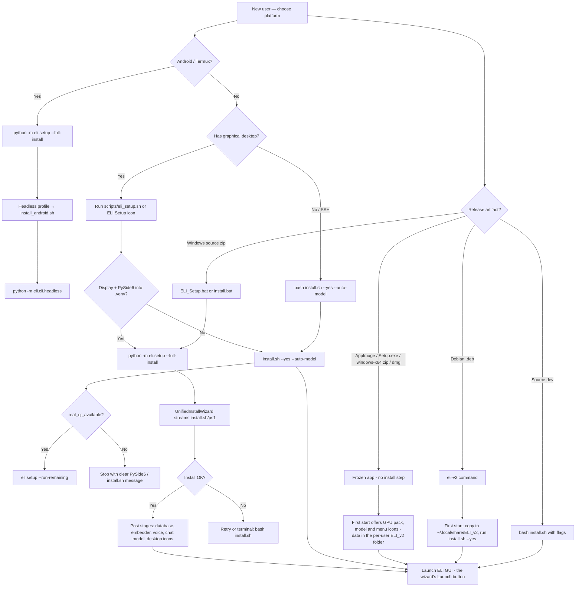

# ELI v2 Script & Setup Reference

**Version:** 2.5.36 (open source under the Apache License 2.0 from this release)  
**Repository:** ELI_MKXI / ELI v2.0  
**Last updated:** 2026-11-20

**Beginner guide:** **[INSTALLATION_GUIDE.md](INSTALLATION_GUIDE.md)**

---

## 1. Executive Summary

| Path | Entry |
|------|-------|
| One-click GUI | `./ELI_Setup.sh` / `eli_setup.sh` / `ELI_Setup.bat` / `ELI-Setup-*.exe` |
| Frozen Linux | AppImage |
| Frozen Windows | `ELI-Setup-*.exe` or zip `ELI.exe` |
| Aliases | `install_eli.sh`, `eli_one_click_setup.sh` → redirect only |

**Wizard core (hard-fail):** env, llama, DB, nomic, Piper/Whisper, chat GGUF.  
**Best-effort:** OS tools (mpv, tesseract, …).  
**Policy:** `eli.setup.hardware_policy` — GPU on NVIDIA/AMD/Arc/Metal; CPU on Iris Xe / ≤8 GB / no dGPU.
- **Shell env fix** (`scripts/fix_eli_shell_env.sh`): installs the `eli-v2` / `eli2` commands for this checkout and clears stale `ELI_PROJECT_ROOT` / ELI_v2 `PYTHONPATH` exports (and an `alias eli=` that points here) when multiple checkouts coexist; wired from `install.sh` post-install.
- **Installation docs** (`first time Installation/INSTALLATION_GUIDE.md`): complete beginner guide to every install script and priority order.

### v2.4.7 highlights

- **AppImage size cap:** GPU packs removed from AppImage (GitHub 2 GiB limit); **portable tarball still bundles** offline `gpu-packs/` (~300 MB larger compressed vs pre-2.4.7).

### v2.4.6 highlights

- **GPU pack auto-install** (`packaging/pyinstaller/eli_gpu_pack.py`): AppImage/portable detects NVIDIA/AMD/Intel and installs verified llama-cpp wheels from bundled assets (network fallback when not bundled).
- **CPU/RAM fit parity** (`eli.core.hardware_profile`): `effective_use_gpu_layers()` returns false when `llama_supports_gpu_offload()` is unavailable or `compute_mode=cpu`; `cpu_ram_fit_config()` sizes ctx/batch from live RAM using the same `smart_fit_config` math as GPU hosts.
- **Startup compute mode** (`eli.gui.panels.startup`): user picks auto / GPU / CPU; persisted in `runtime_settings.compute_mode`.
- **Unified installer UX** (`eli.setup.unified_installer`): `run_unified_installer()` returns `0 if dlg._install_succeeded else 1`; `scripts/eli_setup.sh` GUI-first with minimal venv bootstrap only.
- **Prefill abort on shutdown** (`eli.cognition.gguf_inference`): `llama_set_abort_callback` stops long CPU/GPU prefill immediately, not just between output tokens.

### v2.3.97 highlights

- **Platform matrix** (§1.1): single reference for GPU detection, installer path, release artifact, and known limits per OS.
- **Android headless profile** (`eli.setup.platform_profile`): unified installer routes Termux to `scripts/install_android.sh` with terminal progress UI.
- **WoA arm64 release scoping** (`build_packages.sh`): `windows-arm64-lean`, `windows-arm64`, `wheelhouse-arm64` targets for Snapdragon laptops.

### v2.3.96 highlights

- **Unified GUI installer** (`eli.setup.unified_installer`): single dialog for install backend + post-install asset stages + launch; parses `[ELI-PROGRESS]` markers from shell installers.
- **Integrated GPU layer display**: startup hardware optimizer and GUI model loader show **honest GPU layer counts** based on free VRAM (not total), with force-override env vars documented in §9. Installer copy explicitly states: *"Your GPU layer count will reflect reality this time."*
- **Cross-platform install backend** (`eli.setup.install_backend`): streams `install.sh` (Unix) or `install.ps1` (Windows) into Qt progress signals.

After install, daily use:

- **Desktop GUI:** `./scripts/eli_launch.sh` or `./eli.sh`
- **Web/phone server:** `./scripts/eli_launch.sh serve --lan --https`
- **Terminal command:** `eli-v2` (installed by `install.sh` through `scripts/fix_eli_shell_env.sh`, or by `scripts/install_eli_command.sh`)
- **Android headless:** `.venv/bin/python -m eli.cli.headless`

---

## 1.1 Platform Support Matrix

Authoritative map of what ELI v2 supports today on each host class. Use this when triaging field reports (“0 GPU layers”, “install aborted”, “wrong installer”).

| Platform | CPU arch | Install profile | Entry command | GPU / inference | Layer display | Release artifact |
|----------|----------|-----------------|---------------|-----------------|---------------|------------------|
| **Linux desktop** | x86_64, arm64 | `desktop` | `scripts/eli_setup.sh` → unified GUI | NVIDIA CUDA, AMD ROCm/Vulkan, Intel iGPU Vulkan, Qualcomm Adreno Vulkan (Linux ARM) | Shared-memory fit for iGPU/APU/Adreno | `ELI_v2-*-x86_64.AppImage`, `.deb`, portable tar |
| **macOS Apple Silicon** | arm64 | `desktop` | `bash install.sh` (Metal auto) | Apple Metal / unified memory | “Apple unified memory” label | `ELI_v2-*-macos-arm64.dmg` |
| **macOS Intel** | x86_64 | `desktop` | `bash install.sh` | CPU; discrete AMD/NVIDIA partial via `_macos_gpus()` | Discrete VRAM when reported | None published; on an Intel Mac `pyinstaller --noconfirm --clean ELI.spec` then `bash packaging/macos/build-dmg.sh` |
| **Windows x64** | x86_64 | `desktop` | `ELI-Setup-*.exe`; source: `ELI_Setup.bat` / `install.ps1` | Frozen: CUDA (NVIDIA) or Vulkan (AMD/Intel) GPU pack. Source: CUDA when NVIDIA + wheel available; AMD/Intel → CPU or manual Vulkan build | Registry/CIM GPU names | `ELI-Setup-*.exe`, `ELI_v2-*-windows-x64.zip`; source `ELI_v2-*-windows-portable.zip` / `-portable-full.zip` |
| **Windows on ARM (WoA)** | arm64 | `windows_woa` | Same as Windows; lean arm64 zip | **No CUDA wheels** on arm64; Qualcomm Adreno unified memory; Vulkan experimental | “Snapdragon Adreno” + batch ≤ 32 | `ELI_v2-*-windows-arm64-portable.zip` (**experimental**, `build_packages.sh windows-arm64-lean`) |
| **Qualcomm Snapdragon laptop** | arm64 | `windows_woa` or Linux ARM | Per OS row above | Adreno via Vulkan (llama.cpp); **not** Hexagon NPU/QNN | Shared RAM budget, integrated flag | WoA zip or Linux source install |
| **Intel Iris Xe / UHD** | x86_64 | `desktop` | `install.sh` | Vulkan offload optional; CPU reliable | “Intel Iris Xe” / fit count, not 0 | Any desktop release |
| **AMD APU** | x86_64 | `desktop` | `install.sh` | ROCm if `/dev/kfd`, else Vulkan via amdgpu | “AMD APU” shared-memory fit | Any desktop release |
| **Android / Termux** | arm64 | `android` (headless) | `python -m eli.setup --full-install` or `scripts/install_android.sh` | **CPU only** — source-build llama-cpp | N/A (no GPU layers) | No store bundle; clone + Termux script |
| **Raspberry Pi / SBC** | arm64 | `desktop` (CPU) | `bash install.sh --cpu-only` | CPU only unless vendor adds detection | CPU-only | No dedicated Pi artifact |
| **Hexagon NPU / QNN** | any | — | — | **Not supported** in ELI GGUF stack | — | Requires separate Qualcomm SDK path |

### Profile routing (`eli.setup.platform_profile`)

| `InstallProfile` | Detected when | Installer script | GUI wizard | Post-install launch |
|------------------|---------------|------------------|------------|---------------------|
| `desktop` | Default Linux/macOS/Windows x64 | `install.sh` / `install.ps1` | Yes (Qt) | `python -m eli` |
| `android` | Termux / `platform_compat.is_android()` | `scripts/install_android.sh` | Terminal progress only | `python -m eli.cli.headless` |
| `windows_woa` | `win32` + `platform.machine()` arm64 | `install.ps1` | Yes (Qt) when display available | `python -m eli` |

Detection module: `eli/setup/platform_profile.py`. Backend command resolution: `install_script_for_profile()` in the same module, which `eli/setup/install_backend.py` calls: `bash install.sh --yes [--cpu-only] --auto-model` on Linux/macOS, `install.ps1 -Yes -AutoModel [-CpuOnly]` on Windows, `scripts/install_android.sh` on Android.

### WoA / arm64 release build targets

```bash
bash build_packages.sh windows-arm64-lean      # source + wheel, online pip (recommended)
bash build_packages.sh wheelhouse-arm64        # prefetch win_arm64 wheels (gaps logged)
bash build_packages.sh windows-arm64           # full offline zip (experimental)
```

**CI note:** the release workflow's source-packages job (ubuntu) builds `wheelhouse-arm64` and `windows-arm64-lean` on every tag push and publishes `ELI_v2-<version>-windows-arm64-portable.zip` and `ELI_v2-<version>-wheelhouse-arm64.tar.gz`. The full offline WoA zip is not published.

### Explicitly out of scope (today)

- Qualcomm **Hexagon NPU** via QNN/QAIRT (not llama.cpp GGUF)
- Google TPU, Apple Neural Engine, Intel NPU as inference backends
- Full **PySide6 desktop GUI** on Android (headless by design)
- Prebuilt **CUDA** on Windows arm64 or Android

---

## 2. Installation Decision Tree



**Flag quick reference for `install.sh`:**

| Flag | Effect |
|------|--------|
| `--yes` / `-y` | Non-interactive; auto model via VRAM (also when stdin is not a terminal) |
| `--cpu-only` | CPU PyTorch + CPU llama-cpp (also `ELI_INSTALL_CPU_ONLY=1`) |
| `--gpu` | The GPU build for the GPU found, even where the CPU build would be chosen (Intel iGPU, ≤8 GB RAM with `--yes`); with no GPU found the CUDA build (as Windows `-Gpu`). The last of `--cpu-only` / `--gpu` wins; either beats the environment (`ELI_FORCE_GPU=1` = `--gpu`) |
| `--skip-torch` | Skip PyTorch |
| `--latest` | Use `requirements.txt` ranges instead of frozen lock |
| `--install-cuda` / `--cuda` | When the engine has no GPU offload: best-effort CUDA toolkit + rebuild llama-cpp |
| `--auto-model` / `--auto` | Download VRAM-sized chat model |
| `--choose-model` / `--choose` | Interactive multi-select model menu |
| `--model=KEY` | Download specific catalog key |
| `--no-model` | No chat model and no embedder; the voice weights are still fetched |

---

## 3. Root-Level Shell Scripts


### `install.sh`

| | |
|---|---|
| **Path** | `/install.sh` |
| **When to use** | Primary Linux/macOS installer from a source checkout or portable tree. |
| **Requires** | Python 3.10+, bash, network for deps (models optional). |

**Step-by-step:**

1. Parse CLI flags (`--cpu-only`, `--gpu`, `--skip-torch`, `--latest`, `--install-cuda`, `--yes`, model flags); with neither `--cpu-only` nor `--gpu` on the line, `ELI_INSTALL_CPU_ONLY=1` forces CPU and `ELI_FORCE_GPU=1` the GPU build.
2. Export canonical paths: `ELI_PROJECT_ROOT`, `ELI_DATA_DIR`, `ELI_CONFIG_DIR`, `ELI_MODELS_DIR`, `ELI_CACHE_DIR`, `PYTHONPATH`.
3. Pick the Python (`scripts/eli_env.py pick`, unless `PYTHON` is set): of those installed, the one the most locked packages come ready-made for on this machine. Print **system report**: Python version, CPU/RAM/disk, NVIDIA/AMD/Intel/Qualcomm GPU detection.
4. Confirm plan (unless `--yes` or non-TTY); optional model menu.
5. Check build prerequisites (compiler, Python headers, PortAudio headers, `python3-venv`, the window's system libraries); add them when that needs no password, else print the one command. Create or rebuild `.venv` if broken/copied from another machine (`eli_env.py repair` first, then `eli_env.py create`).
6. Upgrade pip; install PyTorch: the newest CUDA/ROCm/XPU build for this Python and driver (`eli_env.py torch-index`), checked on the GPU, else the oldest on offer, else CPU. MPS on macOS.
7. Install **llama-cpp-python** ≥0.3.35 with GPU-appropriate `CMAKE_ARGS` (NVIDIA: the CUDA wheel index only when it has ≥0.3.35 for this Python, else a CUDA source build with `nvcc`, else a CPU-safe source build); smoke-test `llama_backend_init()` and rebuild with CPU-safe flags on SIGILL.
8. Verify GPU offload when not CPU-only (with `--install-cuda`: fetch `nvcc` and rebuild with CUDA).
9. `pip install -e ".[full]"` (editable, constrained by the lock) or bundled wheel fallback.
10. Install from `requirements.lock.txt` (`requirements-macos.txt` on macOS); on failure the ranges in `requirements-full.txt`, then one requirement at a time (`eli_env.py install-each`).
11. Seed `config/settings.json` from template; mkdir `models/`; copy desktop icon.
12. Install runtime OS tools (mpv, tesseract, ffmpeg, etc.) best-effort.
13. Seed blank DB templates; run `python -m eli.core.init_data`.
14. Regenerate capability manifest.
15. Verify from outside the source folder (`eli_env.py verify`), that the window toolkit really loads (installing PySide6 and naming missing system libraries if not), and the `eli` console script.
16. Optional model download (`eli.core.model_download`, when `models/` holds no GGUF); required embedder (`--aux`, skipped with `--no-model`); voice assets (`eli.runtime.voice_assets`, always).
17. Offer `scripts/fix_eli_shell_env.sh` (`eli-v2` / `eli2` commands; automatic with `--yes`).
18. On Linux: run `scripts/install_desktop_apps.sh`.

**Environment variables:** See §9 (`ELI_PROJECT_ROOT`, `ELI_DATA_DIR`, `ELI_CONFIG_DIR`, `ELI_MODELS_DIR`, `ELI_CACHE_DIR`, `ELI_INSTALL_CPU_ONLY`, `PYTHON`, `CUDACXX`, `CMAKE_ARGS`, `LLAMA_MIN`). `LLAMA_MIN` (default 0.3.35) is read only by the CPU-repair rebuild; the NVIDIA path always asks for 0.3.35 or newer.

**Exit codes:** `0` success (may include warnings); `1` missing Python; `1` when the Python cannot create an environment; `1` when verification found errors ("finished WITH ERRORS"); `0` user abort at confirm prompt. Under `set -euo pipefail` any other failing step also ends it non-zero.

**Progress protocol:** Emits `[ELI-PROGRESS] phase=<name> pct=<0-100> msg=<text>` for GUI installer.

**Related:** `install.ps1`, `eli/setup/install_backend.py`, `scripts/eli_setup.sh`, `scripts/install_desktop_apps.sh`.

---

### `install.ps1`

| | |
|---|---|
| **Path** | `/install.ps1` |
| **When to use** | Windows installer; invoked by `install.bat`, `ELI_Setup.bat` and the GUI wizard (`-Yes -AutoModel [-CpuOnly]`). |
| **Requires** | Python 3.10+ (the floor `eli_env.py versions` reads from `pyproject.toml`), PowerShell. |

**Step-by-step:** Mirrors `install.sh` for Windows: Python pick (`eli_env.py pick`, always — `PYTHON` is not read), system report (including non-NVIDIA GPU detection), venv check/repair/creation, PyTorch (newest CUDA build for this Python and driver unless `-CudaVersion` is given, checked on the GPU, else CPU), llama-cpp-python ≥0.3.35 (CUDA wheel from the `-CudaVersion` index, default `cu121`, else the CPU build) with a check that it starts on this CPU, ELI from a `dist\eli_v2_0-*.whl` if present else editable, requirements lock (fallback: `requirements-windows.txt` ranges, then one at a time), config seed, init_data, capability manifest, FFmpeg / Tesseract / mpv via winget (best-effort), embedder + voice fetch, Start Menu shortcuts (`scripts\install_desktop_apps.ps1`), progress markers. A chat model is downloaded only with `-AutoModel`, `-Model` or a yes at the model prompt; `-Yes` alone downloads none.

**Parameters:** `-CpuOnly`, `-Gpu` (does force the CUDA build without a detected NVIDIA GPU), `-Latest`, `-InstallCuda`, `-Yes`, `-AutoModel`, `-NoModel`, `-Model`, `-CudaVersion`.

**Exit codes:** `1` if no Python at the floor; `0` on "no" at the confirm prompt; a failed venv creation or pip step stops it with an error (non-zero); `0` at the end.

**Related:** `install.bat`, `ELI_Setup.bat`, `eli/setup/install_backend.py`.

---

### `install.bat`

| | |
|---|---|
| **Path** | `/install.bat` |
| **When to use** | Windows double-click entry; parses `/cpu` (or `--cpu-only`), `/cuda` (or `--install-cuda`), `/latest` and delegates to `install.ps1`. |
| **Exit codes:** Passes through PowerShell exit code (`1` if PowerShell is missing). Respects `ELI_INSTALLER_UNATTENDED=1` to skip pause. |

---

### `eli.sh`

| | |
|---|---|
| **Path** | `/eli.sh` |
| **When to use** | Quick Linux/macOS launcher after install (the `eli-v2` command runs it). |
| **What it does:** Sets ELI path env vars (`scripts/eli_isolate_env.sh`); checks the environment can run and mends it if it can (`eli_env_ready`); exec `.venv/bin/python -m eli "$@"`, so every `python -m eli` flag works through it. |
| **Exit codes:** `1` if `.venv` missing or unusable; otherwise ELI main exit code. |

`eli.bat` is the Windows counterpart: it sets the same variables, repairs an environment whose Python was removed (`eli_env.py repair`), then runs `.venv\Scripts\python.exe -m eli`.

---

### `bin/elix` — legacy launcher

| | |
|---|---|
| **Path** | `/bin/elix` (+ `/bin/elix.real`) |
| **When to use** | Legacy; the launchers above replace it. |
| **What it does:** In a terminal, lists the GGUFs under `models/` and asks for one, exports it as `ELI_GGUF_MODEL_PATH` / `ELI_MODEL_PATH` / `ELI_MODEL` / `GGUF_MODEL_PATH`, and saves it into `.env.eli_v2_0`; then `bin/elix.real` sources `.env.eli_v2_0` and runs `python -m eli.gui.app`. Because every later `bin/elix` start loads that file, the saved model takes precedence over the model picked in the app until the lines are removed from `.env.eli_v2_0`. `ELIX_SKIP_MODEL_PICKER=1` (or no terminal) skips the question; `bin/elix.real --list-capabilities` prints `capability_manifest.json`. |
| **Exit codes:** `130` on cancel, `2` on an invalid choice, `1` if `bin/elix.real` is missing. |

---

### `build_packages.sh`

| | |
|---|---|
| **Path** | `/build_packages.sh` |
| **When to use** | Maintainer release builds. |
| **Usage:** `bash build_packages.sh [wheel|wheelhouse|wheelhouse-arm64|deb|appimage|macos|windows|windows-lean|windows-arm64|windows-arm64-lean]` |

**Step-by-step:**

1. Resolve version from `pyproject.toml`; prefer `.venv/bin/python`.
2. Pre-flight: compile all `.py` (git ls-files or find); optional full pytest (`SKIP_TESTS=1` to skip).
3. For each target: invoke sub-builders under `packaging/` or stage Windows zips (`ELI_v2-<v>-windows-portable.zip`, `-windows-portable-full.zip`, `-windows-arm64-portable.zip`, `-windows-arm64-portable-full.zip`, each with `ELI_Setup.bat`, `install.bat`, `install.ps1`, `eli.bat`). `appimage` runs the source-portable `packaging/linux/build-appimage.sh`; `macos` looks for a `packaging/macos/build-macos-app.sh` that does not exist and only prints a note (the dmg comes from `packaging/macos/build-dmg.sh`).
4. Write `dist/SHA256SUMS.txt` and `dist/RELEASE_NOTES.md`.

**Environment:** `SKIP_TESTS`, `SKIP_COMPILE`, `WHEELHOUSE_PYTHON_VERSIONS` (default `311 312`), `ELI_PORTABLE_WHEELHOUSE` (default `1`: offline PySide6 bootstrap wheels in the Windows zips).

**Related:** All `packaging/*/build-*.sh`, `scripts/package_desktop_app.sh`.

---

### `eli_diagnose.sh`

| | |
|---|---|
| **Path** | `/eli_diagnose.sh` |
| **When to use** | Lightweight dev diagnostic (router stages, CapabilitySync introspection). |
| **What it does:** Writes temp Python script; runs static analysis on `router_enhanced.py` and imports `CapabilitySync`. **Read-only — no modifications.** |
| **Exit codes:** Implicit 0 (no `set -e` on python failure). |

---

### `eli_diag.sh`

| | |
|---|---|
| **Path** | `/eli_diag.sh` |
| **When to use** | Full wiring audit (weather plugin, shell routing, news, agents, FAISS paths, introspection, plugins, DB tables). |
| **What it does:** Greps key source files; runs embedded Python for DB audit. **Read-only.** |
| **Note:** DB paths hardcoded to `~/Desktop/ELI_v2.0` in one section — adjust for your install root. |

---

### `run_tests.sh`

| | |
|---|---|
| **Path** | `/run_tests.sh` |
| **When to use** | Developer test runner. |
| **Modes:** `full` (default), `claims`, `imports`, `fast`, `html`. |
| **What it does:** Installs `requirements-test.txt`; runs pytest with JUnit/HTML reports under `test_reports/`. |
| **Exit codes:** pytest exit (html/full use `|| true` for non-zero). |

---

### `test_eli_wiring.sh`

| | |
|---|---|
| **Path** | `/test_eli_wiring.sh` |
| **When to use** | Quick CI/local wiring smoke test from repo root. |
| **What it does:** Checks critical dirs; imports core modules; tests `route()` samples; executor smoke (TIME, DATE, LIST_CAPABILITIES); verifies grounding gate, script guard, world model, proactive daemon. |
| **Exit codes:** `1` on any failure; `0` all passed. |

---

## 4. `scripts/` Directory

The shell scripts under `scripts/` (31 files), then the Python and PowerShell helpers the installers and launchers call. Paths relative to repository root.


### `scripts/eli_setup.sh` — **Primary first-time setup (v2.3.96)**

| | |
|---|---|
| **When to use** | **Recommended entry for new users** on Linux/macOS with a display. |
| **Flow** | 0) Hardware policy: `ELI_INSTALL_CPU_ONLY` if set, else `python3 -m eli.setup.hardware_policy` (`gpu`/`cpu`). Android/Termux: `python3 -m eli.setup --full-install --launch`. 1) If DISPLAY/WAYLAND: make a minimal `.venv` (`eli_env.py create`), install PySide6 into it (`requirements-portable-bootstrap.txt`, wheelhouse first), then `.venv/bin/python -m eli.setup --full-install` (log: `artifacts/setup_gui.log`). 2) If that did not finish: `install.sh --yes [--cpu-only] --auto-model` (the other build on failure), then `exec .venv/bin/python -m eli.setup --run-remaining`. Outside Android it does not launch ELI itself (the wizard's Launch button does); it takes no arguments. |
| **Exit codes** | `0` GUI success; `1` no `python3`, core install incomplete, or PySide6 missing; otherwise the exit code of `eli.setup --run-remaining`. |

---

### `scripts/eli_launch.sh` — Unified runtime launcher

| Mode | Command | Action |
|------|---------|--------|
| GUI (default) | `./scripts/eli_launch.sh` | Desktop app via `python -m eli` |
| Server | `... serve [--lan] [--https]` | Delegates to `eli_serve.sh` |
| Both | `... both` | Server background + GUI |

**Exit codes:** `1` missing venv; `2` unknown mode.

---

### `scripts/eli_serve.sh` — API / web-app server

Binds FastAPI server (`python -m api.server`). Default `127.0.0.1` (tokenless); `--lan` → `0.0.0.0` + token (a stable one saved under the config folder unless `--token` is given); `--https` adds HTTPS on port 8443 for the phone mic; `--port N` (default `ELI_API_PORT`, else the saved `api_port` setting, else 8081). Auto-fetches voice assets if missing. Sets `ELI_API_HOST`, `ELI_API_PORT`, `ELI_API_TOKEN`, `ELI_API_HTTPS`. **Exit codes:** `1` missing venv; `2` unknown argument.

---

### `scripts/eli_startup.sh` — Smart startup pipeline

Install-if-needed (`--setup` forces `scripts/eli_setup.sh`), optional GitHub asset restore (`scripts/restore_github_asset_files.py`; after setup when the same run does one), llama-cpp SIGILL repair via `install.sh --yes --cpu-only --auto-model`, optional trace, tee logs to `artifacts/startup/logs/`. Default auto-setup when `.venv` missing. Arguments it does not know (or after `--`) go to `python -m eli`.

**Flags:** `--setup`, `--no-setup`, `--with-github-assets`, `--repo`, `--tag`, `--trace` (`ELI_PIPELINE_TRACE=1`), `--safe-mode` (sets `ELI_SAFE_MODE=1`: ELI starts no proactive daemon and loads no plugin at start; a plugin enabled during the session still loads, and MCP servers start only when one of their tools is used, as always), `--no-log`.

**Exit code `132`:** llama-cpp still broken after repair.

---

### `scripts/eli_one_click_setup.sh` — compatibility alias

Redirects to `scripts/eli_setup.sh`. `--cpu-only` sets `ELI_INSTALL_CPU_ONLY=1` first; every other option is ignored.

---

### `scripts/eli_one_click_run.sh`

Thin wrapper → `scripts/eli_startup.sh`.

---

### `scripts/install_eli.sh`

Compatibility alias: redirects to `scripts/eli_setup.sh` (the old pip-only install is gone).

---

### `scripts/safe_install_linux.sh` — Hardened security-focused install

Fresh venv (deletes existing), backs up secrets, runs `install.sh --yes --no-model`, rotates API token and HMAC key, hardens `settings.json` (network off, full_control off, etc.), writes `config/safe_install.env`, runs security pytest subset.

**Flags:** `--skip-deps`, `--gpu`, `--cpu-only`.

---

### `scripts/install_desktop_apps.sh`

Runs `python -m eli.runtime.desktop_launchers install`: writes **ELI v2.0**, **ELI Server**, **ELI Setup** and **Uninstall ELI v2.0** entries (`~/.local/share/applications/eli-v2*.desktop`, Linux) or `.command` launchers (macOS), or prints the Windows PS1 command. Every entry starts `~/.local/bin/eli-v2-run <action>`, a guard script with zenity error dialogs that reads the install-root pointer (`~/.local/share/ELI_v2/runtime/install_root`), so no extract-folder path is written into an entry. It only replaces or removes ELI v2's own entries. `scripts/install_desktop_apps.ps1` does the same for Start Menu shortcuts through `%LOCALAPPDATA%\ELI_v2\eli-run.cmd`.

---

### `scripts/install_eli_command.sh`

Installs `~/.local/bin/eli-v2` (or `--name` / `ELI_COMMAND_NAME`, in `--bin-dir` / `ELI_BIN_DIR`), a wrapper that runs this checkout's `eli.sh` (which clears stale `ELI_*` env first). Options: `--name`, `--bin-dir`, `--force` (replace an existing command; without it an existing one stops the script).

---

### `scripts/fix_eli_shell_env.sh`

Installs the `eli-v2` + `eli2` commands for this checkout (`install_eli_command.sh --force`), removes this checkout's stale `alias eli=` lines, exported `ELI_PROJECT_ROOT` and ELI_v2 `PYTHONPATH` lines, and writes a managed "ELI v2 launcher" block (aliases `eli-v2`, `eli2`) into `~/.bashrc`, `~/.bash_aliases`, `~/.profile`. Run after install when v2/v3 or multiple folders coexist. Wired from `install.sh` post-install prompt (automatic with `--yes`). Options: `--yes`, `--force`.

---

### `scripts/eli_uninstall.sh`

Stops processes from this install; removes ELI v2's desktop entries, `~/.local/bin/eli-v2-run`, older v2-only entries (and an old `~/.local/bin/eli` that names v2) and v2's theme icon; then asks whether to delete the install folder. `--yes` removes the integration without asking and keeps the folder; `--purge` also deletes the folder. It does not remove `~/.local/bin/eli-v2` / `eli2`, the shell block `fix_eli_shell_env.sh` wrote, or the install-root pointer. `scripts/uninstall.ps1` (via `UNINSTALL.bat`) removes the Start Menu shortcuts and optionally the folder on Windows.

---

### `scripts/eli_term.sh`

Opens a command in a detected terminal emulator (GNOME/KDE/XFCE/…); holds window open. Fallback: run headless.

---

### `scripts/package_desktop_app.sh`

Builds `dist/app_packages/ELI_v2-<ver>-linux-portable.tar.gz` (+ `.sha256`) via git archive; embeds `INSTALL_ELI.sh` and `ELI_Setup.sh` (→ `scripts/eli_setup.sh`), `RUN_ELI.sh` (→ `scripts/eli_startup.sh`), `README_INSTALL.txt`, a wheel built from the staged tree, an offline PySide6 wheelhouse (`ELI_PORTABLE_WHEELHOUSE=1`, default; `ELI_FULL_WHEELHOUSE=1` for the whole lock, `ELI_BUNDLE_TORCH=1` for a CPU torch wheel), the newest CUDA/Vulkan packs as `gpu-packs/` (from a local `gpu-packs/` or the `gpu-packs` release via `gh`), and a starter model with the embedder and the amy voice when `models/` has one (`ELI_STARTER_MODEL`, default `Qwen2.5-3B-Instruct-Q4_K_M.gguf`). Options: `--with-assets` (all of `models/` and `tts_piper/`; the release build uses it), `--skip-wheel`, `--out-dir`, `--repo`, `--tag`.

---

### `scripts/build_v2_release.sh`

Wrapper: `SKIP_TESTS=1 package_desktop_app.sh`.

---

### `scripts/build_grandma_release.sh`

Portable tar + AppImage + publish instructions.

---

### `scripts/sync_build.sh`

Rsync `eli/`, `api/`, `config/` into existing portable staging tree. `--dry-run` supported.

---

### `scripts/package_eli_release.sh`

Build wheel/sdist via `python -m build`.

---

### `scripts/install_android.sh`

Termux headless install: pkg deps, CPU llama-cpp source build, `requirements-android.txt`, no GUI/CUDA.

Also invoked automatically when `eli.setup.platform_profile` detects Android (`python -m eli.setup --full-install`). Emits `[ELI-PROGRESS]` markers for the unified installer's terminal UI.

---

### `scripts/purge_legacy_eli.sh`

**Requires root.** Removes old system ELI (`/opt/eli`, `/etc/eli`, apt package). `--yes`, `--dry-run`.

---

### `scripts/restore_github_assets.sh`

Download and reassemble split release archives for models/voice. Requires `gh auth login`. Options: `--repo`, `--tag`, `--from-dir`, `--keep-archives`.

---

### `scripts/create_github_asset_archives.sh`

Build split tar chunks under `dist/github_assets/upload/` for GitHub release upload.

---

### `scripts/upload_github_assets.sh`

Upload asset chunks to GitHub Release via `gh`.

---

### `scripts/run_eli_repo_venv.sh`

Isolate the environment (`eli_isolate_env`, `eli_env_ready`), activate `.venv`, source optional `.env.eli_v2_0`, unset the model env vars (so a model the legacy `bin/elix` saved there cannot bypass the picker), launch `python -m eli.gui.app --setup`.

---

### `scripts/coverage_full.sh`

Four-lane combined coverage report → `artifacts/coverage_report.txt` + HTML.

---

### `scripts/eli_bt_reset.sh`

**Requires root.** Reset stuck USB Bluetooth adapter (btusb reload).

---

### `scripts/generate_blueprint_pdfs.sh`

Rebuild shipped blueprint PDFs from markdown (pandoc + xelatex). Optional single-stem arg.

---

### `scripts/generate_all_blueprint_pdfs.sh`

Rebuild all `blueprints/*.pdf` from sources; delegates to `generate_blueprint_pdfs.sh` for composite manuals.

---

### `scripts/generate_new_user_guide_pdf.sh`

Rebuild `blueprints/new_user_install_guide.pdf` only.

---

### `scripts/eli_isolate_env.sh`

Sourced by the launchers. `eli_isolate_env ROOT` unsets inherited `VIRTUAL_ENV` / `ELI_*` folder variables, points `ELI_PROJECT_ROOT`, `ELI_DATA_DIR`, `ELI_CONFIG_DIR`, `ELI_MODELS_DIR`, `ELI_CACHE_DIR` and `PYTHONPATH` at ROOT and drops other ELI checkouts' `.venv` from `PATH`. `eli_env_ready ROOT` checks that `.venv` can run ELI and otherwise runs `scripts/eli_env.py repair` or says to run `bash install.sh`.

---

### `scripts/fix_eli_desktop_icons.sh`

Removes or rewrites stale `eli*.desktop` entries (menu and Desktop) that still point at a deleted portable folder; `--install` also rewrites the launchers for this tree.

---

### `scripts/eli_env.py` (standard library only)

The Python environment helper the installers and launchers call: `pick` (the interpreter a new install uses), `versions` (Python versions `pyproject.toml` declares), `torch-index cuda|rocm|xpu|cpu`, `status [ROOT]` (exit `3` when `.venv` is unusable), `repair [ROOT]`, `create [ROOT]`, `install-each ROOT FILE` (one requirement at a time), `verify [ROOT] [--strict]` (exit `8` under `--strict` when installed packages were built for other versions of each other). See `blueprints/commands_and_installers.md` for what each one decides.

---

### `scripts/eli_serve.ps1`

Windows counterpart of `eli_serve.sh`: `-Lan`, `-Https`, `-Port <n>` (default 8081), `-Token <s>`; repairs the environment first if its Python is gone.

---

## 5. Packaging Builders


### `packaging/linux/build-appimage.sh`

| | |
|---|---|
| **When to use** | Grandma-friendly AppImage from portable tarball (requires host Python 3.10+). Releases do not publish this one: their AppImage is the frozen build below. |
| **Usage** | `bash packaging/linux/build-appimage.sh [version]` |
| **Steps** | Build/find portable tar → stage AppDir → write `AppRun` (first launch → `~/.local/share/ELI_v2`, run ELI_Setup) → appimagetool → SHA256. |
| **Env** | `ELI_INSTALL_ROOT`, `ELI_APPIMAGE_FORCE_SYNC`, `SKIP_TESTS`. |
| **Fallback** | If appimagetool missing, downloads from GitHub releases. |

---

### `packaging/linux/build-appimage-pyinstaller.sh`

Frozen **PyInstaller** one-dir bundle → `dist/ELI_v2-<v>-<arch>.AppImage` (the release's). **No host Python required.** Prerequisite: `pyinstaller --noconfirm ELI.spec` → `dist/ELI/`. Ships LICENSE, NOTICE and THIRD_PARTY_NOTICES.md in the AppDir; mutable state → `~/.local/share/ELI_v2`. Measures the oldest glibc the bundle starts on (`packaging/linux/glibc_floor.py`) and writes it into the AppImage, whose launcher refuses an older system with a sentence (and a dialog). Uses `appimagetool` from PATH, else downloads the current one (falling back to the AppImageKit 13 release).

---

### `packaging/debian/build-deb.sh`

Lean `.deb` (about 10 MB at v2.5.35): `dist/app_packages/ELI_v2-<v>-amd64.deb`, package `eli-v2`; git archive to `/opt/eli-v2`, `/usr/bin/eli-v2` first-launch installer to `~/.local/share/ELI_v2` (copies the tree, runs `install.sh --yes`). Declares the build and window system libraries as dependencies. Requires `dpkg-deb`.

---

### `packaging/macos/build-dmg.sh`

**macOS only.** Packages `dist/ELI.app` (PyInstaller) into drag-to-Applications `.dmg`; ad-hoc codesign; copies LICENSE/NOTICE.

---

### `packaging/windows/build-windows.ps1`

**Windows only.** Extracts lean portable zip (builds it with `bash build_packages.sh windows-lean` when missing); writes `ELI_Setup.bat`; invokes Inno Setup (`iscc.exe`, `packaging/windows/ELI_Setup.iss`) → `ELI_v2-<ver>-Setup.exe`, the source-portable installer. `-Version` defaults to `pyproject.toml`'s.

---

### `packaging/windows/installer.iss`

Inno Setup script for the frozen bundle (`dist\ELI\`): `iscc packaging\windows\installer.iss /DMyAppVersion=<version>` → `dist\ELI-Setup-<version>.exe`, the installer releases publish. Per-user install to `%LOCALAPPDATA%\Programs\ELI` (no admin); data stays in `%LOCALAPPDATA%\ELI_v2` and survives an uninstall; a "Fresh install" task resets settings and memory but keeps downloaded models and the GPU pack; installs the Visual C++ runtime when missing. The GPU pack is not downloaded by Setup: ELI offers it on first start.

---

## 6. Python Install / Setup Entry Points

### `python -m eli.setup` (`eli/setup/__main__.py`)

| Flag | Action |
|------|--------|
| `--full-install` | Unified GUI installer (install.sh backend + assets + optional launch); on Android / Termux the terminal installer (`scripts/install_android.sh`) |
| `--wizard` | Graphical setup wizard (post-install stages) |
| `--run-remaining` | Complete incomplete setup stages |
| `--launch` | Launch ELI after wizard |
| `--status` | Print stage checklist and exit (`0` when every stage is complete, else `1`) |

**Module map:**

| Module | Purpose |
|--------|---------|
| `unified_installer.py` | Qt dialog: streams shell install, shows phase progress, stage checklist, retry/launch |
| `install_backend.py` | Cross-platform subprocess driver; parses `[ELI-PROGRESS]` and line hints |
| `install_messages.py` | Rotating installer copy per phase (ELI voice) |
| `status.py` | Read-only checks: venv, chat model, embedder, voice, desktop launcher |
| `wizard.py` | Post-install wizard worker (model pick, hardware tuning) |
| `hardware_policy.py` | GPU-or-CPU decision for `scripts/eli_setup.sh` and the wizard (`python -m eli.setup.hardware_policy` prints `gpu` or `cpu`; `ELI_INSTALL_CPU_ONLY` / `ELI_FORCE_GPU` win). `install.sh` run by hand does its own detection |
| `platform_profile.py` | Install profile (`desktop`, `android`, `windows_woa`) and the install command for it |

### `python -m eli` (`eli/__main__.py`)

Default → GUI (`eli.gui.app`). Flags: `--headless` / `-H` (terminal REPL), `--trust-agent <path> [--force]`, `--mcp-server` (ELI as an MCP server on stdin/stdout), `--mcp-config [--allow-control]` (print the `mcpServers` entry for another app), `--license` / `--licence` (print the Apache-2.0 terms). Calls `init_data.bootstrap_once()` before the REPL or the GUI starts (the licence, MCP and trust-agent flags return before it). The `eli` / `eli-gui` console scripts in `.venv/bin` enter `eli.gui.app:main` directly, so these flags do not reach them: use `python -m eli` or `./eli.sh`.

### `eli/gui/app.py`

Hardware-aware launcher: detects free VRAM via `eli.core.hardware_profile`, model discovery, GPU layer budgeting, spawns main Pro GUI. **v2.3.96:** integrated display of fitted GPU layers in startup/load probe output.

### `python -m eli.core.init_data`

Idempotent full database architecture (blank slate). Called from installers and boot.

### `python -m eli.core.model_download`

Install-time GGUF catalog downloader. `<key>` (a catalog model), `--list`, `--auto` (sized to free VRAM), `--choose`, `--aux` (embedder), `--aux-all` (embedder + the optional vision model and its projector), `--aux <key>`; `--no-model` is the shell scripts' companion. A chat-model download also fetches the embedder. Writes into `paths.models_dir()`.

### `python -m eli.runtime.voice_assets`

Fetches faster-whisper + Piper voice weights; idempotent; netguard-gated.

### Windows companion flow

`ELI_Setup.bat` in the Windows source zips (`build_packages.sh`):

1. No `.venv` yet → `install.ps1 -Yes -AutoModel`
2. `.venv\Scripts\python.exe -m eli.setup --full-install --launch`
3. If that fails → `install.ps1 -Yes`, then `python -m eli.setup --run-remaining --launch`

The `ELI_Setup.bat` that `packaging/windows/build-windows.ps1` writes for its `ELI_v2-<v>-Setup.exe` runs steps 1 and 2 without `--launch` and points at `eli.bat` afterwards.

---

## 7. Frozen / AppImage Entry Points

### `packaging/pyinstaller/eli_entry.py`

PyInstaller frozen entry. Modes:

| Mode | Behavior |
|------|----------|
| (default) | GUI via `eli.gui.app:main`, after the one-instance check and the first-run offers (GPU pack, CPU-runtime check, a model, menu integration on Linux) |
| `--server` | `api.server:main` (also the default for the `ELI-Server` / `ELI-Server.exe` executable) |
| `--selftest` | Boot the real import stack (database bootstrap, GUI module, server, QR, formulas, llama_cpp from disk), verify mutable paths are outside the read-only bundle, report GPU offload; exit 0/1. CI runs it on every bundle |
| `--license` / `--licence` | Print the Apache-2.0 terms ELI ships under (`eli.runtime.license_info`). Printed to stdout, so on Windows use `ELI-Server.exe --license`: `ELI.exe` has no console |
| `--install-gpu-pack [--vulkan] [--force]` | Install the GPU pack (`eli_gpu_pack.py`) |
| `--remove-gpu-pack` | Delete `<ELI root>/runtime/gpu`; ELI runs on the CPU and offers the pack again |
| `--fresh-start [--yes] [--purge-models]` | Wipe the per-user ELI data, keeping `models/` and `runtime/` (the GPU pack) unless `--purge-models` |
| `--integrate` / `--uninstall` | Linux AppImage: add/refresh, or remove, the menu entries and `~/.local/bin/eli-v2` (`--uninstall` offers to delete the data) |
| `-c` / `-m` | Python passthrough for self-spawned helpers |

Calls `multiprocessing.freeze_support()` first; clears `QT_STYLE_OVERRIDE`.

### `packaging/pyinstaller/eli_gpu_pack.py`

Post-install GPU acceleration for frozen builds. CPU llama-cpp ships in bundle; CUDA/Vulkan wheels download to `<ELI root>/runtime/gpu/llama_cpp` and shadow bundled copy on next launch. `ELI_DISABLE_GPU_PACK=1` starts on the bundled copy instead.

**Invoke:** `ELI --install-gpu-pack [--vulkan] [--force]`

Backends: NVIDIA (the official CUDA wheel index, picked by driver version; when it has nothing new enough — it stops below what current models need — the CI-built CUDA pack from the `gpu-packs` release), AMD, Intel (Arc or integrated) and Qualcomm Adreno (Vulkan from the `gpu-packs` release, automatically; `--vulkan` forces it), Apple Metal (built-in). On first run a portable tarball's bundled `gpu-packs/` is installed before anything is downloaded.

---

## 8. `eli/` Package Map

The `eli/` package contains **451 Python modules**: 2 at the package root and the rest in **22 subpackages** (excluding `__pycache__`). Each entry lists the module path and the opening sentence of its module docstring ("Module in the ELI v2 runtime." where the module has none).

### Root-level (`eli/`)

- `__init__.py` — ELI.
- `__main__.py` — Console entry point.

### `cli/` (2 modules)

- `cli/__init__.py` — Module in the ELI v2 runtime.
- `cli/headless.py` — Headless terminal REPL for ELI v2.0.

### `coding/` (12 modules)

- `coding/__init__.py` — ELI coding agent — frontier-grade code generation, analysis & repair.
- `coding/agent.py` — CodeAgent — the orchestrator that composes ELI's coding capabilities.
- `coding/bug_memory.py` — Semantic bug classification + long-term memory of bugs and fixes.
- `coding/code_mode.py` — Code-mode — the model writes a small program against ELI's own capabilities.
- `coding/cost.py` — Cost estimation + the "should this run in the background?" decision.
- `coding/plan_graph.py` — Subtask DAG for the coding engine — structured decomposition with dependencies.
- `coding/planner.py` — Structured decomposition — planner / implementer separation.
- `coding/repo_context.py` — Repo-context retrieval for the coding agent (Advancement C).
- `coding/restricted_exec.py` — In-process restricted execution for code-mode.
- `coding/sandbox.py` — Bounded, isolated execution substrate for ELI's coding agent.
- `coding/search.py` — Tree/beam search over candidate solutions with UCB-style exploration.
- `coding/verification.py` — Explicit verification gating, candidate scoring, and test synthesis.

### `cognition/` (52 modules)

- `cognition/__init__.py` — Module in the ELI v2 runtime.
- `cognition/action_trust.py` — Whether the loaded model can be left to choose an action.
- `cognition/agent_bus.py` — Multi-agent orchestration layer for ELI.
- `cognition/agent_spec.py` — A real specification for a custom agent — objective, prompt, triggers, measures.
- `cognition/agent_trust.py` — Trust for custom agent code — provenance, not just a hash in a dict.
- `cognition/belief.py` — Belief revision — what ELI holds, how strongly, and what it takes to change it.
- `cognition/chat_grounding_gate.py` — Fail-closed CHAT gate — skip LLM when user-fact grounding is required but absent.
- `cognition/chat_template.py` — A model's own chat format, rendered from the template stored in its GGUF file.
- `cognition/context_budget.py` — Sizing and trimming the memory block that goes into a prompt.
- `cognition/context_synthesiser.py` — Module in the ELI v2 runtime.
- `cognition/correction_patterns.py` — Shared patterns for user correction / dispute turns.
- `cognition/emotion_palette.py` — Emotion / tone palette — the shared taxonomy ELI expresses through.
- `cognition/emotion_timeline.py` — Emotion timeline — the durable record of how the USER has been feeling.
- `cognition/engagement_tracker.py` — Engagement / salience tracker — topic-depth awareness.
- `cognition/evidence_format.py` — Dates on evidence lines, from each row's own timestamp.
- `cognition/exact_recall_value.py` — A single value asked for by name, read from what the person said earlier.
- `cognition/explicit_output_contract.py` — Conservative, model-output-based exact-answer formatting for ELI.
- `cognition/expression_state.py` — Live avatar/expression state — the thin bridge that lets ELI's face react in real time to what he's *doing*, not just what he's feeling.
- `cognition/gguf_inference.py` — GGUF inference for ELI — model-agnostic.
- `cognition/grounded_status.py` — Module in the ELI v2 runtime.
- `cognition/hyde.py` — HyDE — Hypothetical Document Embeddings for ELI.
- `cognition/inference_broker.py` — Module in the ELI v2 runtime.
- `cognition/introspection_agent.py` — Module in the ELI v2 runtime.
- `cognition/learning_coordinator.py` — Stage 12 coordinator — single entry for post-response learning and persistence hooks.
- `cognition/llm_intent.py` — Model-grounded intent resolver (local GGUF, model-agnostic).
- `cognition/memory_diag.py` — What memory retrieval actually did this turn, from telemetry, so ELI never has to guess why.
- `cognition/model_identity.py` — Model-agnostic identity: chat family + thinking from GGUF metadata.
- `cognition/model_load_diagnostics.py` — Say why a GGUF would not load — for ANY model, not a known list of them.
- `cognition/model_output_tokens.py` — Canonical special tokens, stop sequences, and persona drift patterns for all GGUF families.
- `cognition/orchestrator.py` — Module in the ELI v2 runtime.
- `cognition/output_governor.py` — Module in the ELI v2 runtime.
- `cognition/persona.py` — Canonical persona authority for ELI.
- `cognition/persona_hygiene.py` — Cleans up the persona auto-overlay (persona.auto.txt) by deduplicating entries, pruning stale patterns, and capping section sizes.
- `cognition/persona_status.py` — Module in the ELI v2 runtime.
- `cognition/persona_updater.py` — Runs the persona auto-overlay update at boot and after reflection cycles.
- `cognition/persona_values.py` — Module in the ELI v2 runtime.
- `cognition/personal_context_gate.py` — Gate when past-session plans/projects may enter the persona handoff.
- `cognition/prompt_dedupe.py` — One copy of each line of evidence or dialogue per prompt.
- `cognition/query_planner.py` — Deterministic query planning: the time window a question asks about.
- `cognition/reasoning_modes.py` — Module in the ELI v2 runtime.
- `cognition/reranker.py` — Module in the ELI v2 runtime.
- `cognition/scoring.py` — Canonical scoring + confidence primitives for ELI.
- `cognition/self_claims.py` — What ELI may say about its own workings, and the record it says it from.
- `cognition/stance_capture.py` — Notice when ELI has taken a position, so it survives the conversation.
- `cognition/stance_store.py` — Persistence for beliefs — ELI's own positions, and the record of revisions.
- `cognition/supplied_in_message.py` — What a message brings with it: facts to reason from, and text that is material rather than orders.
- `cognition/tone_adaptor.py` — Tone adaptor — decides the emotion ELI *expresses* and feeds every output channel.
- `cognition/tone_analyzer.py` — Lightweight tone/communication-style analyzer.
- `cognition/turn_dossier.py` — Turn dossier — single assembly point for awareness, memory, and cognition context.
- `cognition/user_claim_validator.py` — Post-generation validation of user-attribution claims in CHAT output.
- `cognition/user_info_builder.py` — Module in the ELI v2 runtime.
- `cognition/working_memory.py` — Session-level Working Memory for ELI.

### `contracts/` (3 modules)

- `contracts/__init__.py` — Module in the ELI v2 runtime.
- `contracts/grounded_control.py` — Grounded-control synthesis guard for ELI.
- `contracts/runtime_status.py` — Canonical runtime-status contract for ELI.

### `core/` (33 modules)

- `core/__init__.py` — Module in the ELI v2 runtime.
- `core/cognition_tunables.py` — Central registry of user-tunable cognition / knowledge-gathering parameters.
- `core/confidence.py` — The one confidence-score to label mapping.
- `core/config.py` — Configuration manager for ELI - thin shim over runtime_settings.
- `core/crisis_guard.py` — Crisis / self-harm detection — STT-robust, punctuation- and grammar-agnostic.
- `core/dag.py` — Generic directed-acyclic-graph engine — shared scheduling primitive.
- `core/db_paths.py` — Database path resolution — delegates to core.paths.
- `core/full_control.py` — ELI Full Control — a single master override that lifts ELI's safety barriers.
- `core/gguf_sizes.py` — What a GGUF model costs in memory, read from the file and corrected by what llama.cpp reports.
- `core/gpu_pack_runtime.py` — Activate the optional GPU pack before llama_cpp is imported (AppImage/portable).
- `core/grounding.py` — Single source of truth for grounded-query detection.
- `core/hardware_profile.py` — eli.core.hardware_profile — auto-detect optimal runtime configuration.
- `core/host_env.py` — The environment a program ELI starts should see: the machine's own, not the bundle's.
- `core/init_data.py` — First-run data initialiser — build ELI's FULL database architecture up front.
- `core/legacy_paths.py` — Module in the ELI v2 runtime.
- `core/llama_cpu_compat.py` — CPU compatibility for llama-cpp-python — parity with GPU probe/fallback policy.
- `core/load_plan.py` — What a model loads with on this machine, and where each part of it goes, measured before it loads.
- `core/mem_units.py` — One place to turn bytes into the memory/model-size figures ELI reports and compares.
- `core/memory_reset.py` — ELI memory / identity factory-reset — reusable core.
- `core/model_download.py` — Curated GGUF model download helper.
- `core/model_tier.py` — Model-capability tier — the single signal that lets ELI's cognition budgets auto-scale to whatever model is loaded, so a bigger/smarter local model is used to its potential instead of staying…
- `core/moe_offload.py` — Keep a mixture-of-experts model's expert tensors in RAM and everything else on the GPU.
- `core/netguard.py` — Central network gating for ELI.
- `core/paths.py` — ELI Path Resolution — Single Source of Truth
- `core/portable_paths.py` — Module in the ELI v2 runtime.
- `core/runtime_settings.py` — Module in the ELI v2 runtime.
- `core/secure_io.py` — Race-free writing of files that must never be world-readable.
- `core/self_provenance.py` — Is this row ELI's own bookkeeping, or evidence about the user?
- `core/singleton_refs.py` — Keep None, True and False from being freed by an extension that drops references to them.
- `core/sqlite_util.py` — Shared SQLite pragmas — WAL with a portable-safe fallback.
- `core/startup_hardware_optimizer.py` — A model's trained context, the context free RAM holds, and the reasoning-mode budgets sized from the context that loaded.
- `core/toml_util.py` — Load TOML on Python 3.10+ (tomli backport) and 3.11+ (stdlib tomllib).
- `core/worldclock.py` — Place-aware wall-clock answers.

### `execution/` (14 modules)

- `execution/__init__.py` — Module in the ELI v2 runtime.
- `execution/app_aliases.py` — Speech-damage layer for app names, on top of the cross-platform resolver.
- `execution/command_dependency_graph.py` — Dependency edges between an already-split command list — mirrors eli/coding/plan_graph.py's decompose_dag() shape (same LLM-optional, fallback-to-independent philosophy, same eli.core.dag…
- `execution/command_sequence_log.py` — Durable per-step record for MULTI_COMMAND so a crash mid-sequence leaves a real trace, and a resubmit of the same phrase doesn't re-run steps that already succeeded.
- `execution/effectors/system_helpers.py` — Cross-platform system helpers shared by executor and effectors (v3).
- `execution/execution_planner.py` — Module in the ELI v2 runtime.
- `execution/executor_enhanced.py` — Module in the ELI v2 runtime.
- `execution/media_runtime.py` — Media runtime control for ELI.
- `execution/operator_actions.py` — Module in the ELI v2 runtime.
- `execution/operator_policy.py` — Module in the ELI v2 runtime.
- `execution/portable_intent_contract.py` — Module in the ELI v2 runtime.
- `execution/route_contracts.py` — Module in the ELI v2 runtime.
- `execution/router_enhanced.py` — Module in the ELI v2 runtime.
- `execution/shell_gate.py` — Centralised shell-command safety gate.

### `gui/` (28 modules)

- `gui/__init__.py` — Module in the ELI v2 runtime.
- `gui/app.py` — ELI Launcher — hardware-aware model selector with auto-tuned parameters.
- `gui/branding.py` — Shared ELI branding assets (window icon, Freedesktop theme, Windows .ico).
- `gui/code_editor.py` — Native code editor for the IDE — PySide6/PyQt, no QScintilla required.
- `gui/coding_tab.py` — ELI v2.0 — Coding tab.
- `gui/docks/__init__.py` — ELI v2.0 package marker.
- `gui/docks/operator_console_dock.py` — Governed operator console for proposals, goals, autonomy policy, event feed, scheduler attention, and ranked operator priority.
- `gui/docks/proactive_dock.py` — Proactive Dock GUI
- `gui/eli_pro_audio_gui_v2_0.py` — ELI v2.0 — desktop GUI.
- `gui/labs_tab.py` — ELI v2.0 — Labs Tab
- `gui/off_thread.py` — Blocking work off the Qt window's thread, with the window kept alive meanwhile.
- `gui/panels/__init__.py` — ELI v2.0 GUI panel components.
- `gui/panels/_qt.py` — Shared Qt import shim for eli.gui.panels modules.
- `gui/panels/agent_wizard.py` — ELI v2.0 — Agent edit dialog panel.
- `gui/panels/permission_dialog.py` — The consent dialog — the moment the operator actually decides.
- `gui/panels/settings.py` — ELI v2.0 — Advanced Settings dialog panel.
- `gui/panels/startup.py` — ELI v2.0 — Startup panel components.
- `gui/qt_compat.py` — Qt binding compatibility shim.
- `gui/tabs/__init__.py` — Module in the ELI v2 runtime.
- `gui/tabs/eli_world_tab.py` — Module in the ELI v2 runtime.
- `gui/tabs/experimental_tab.py` — Module in the ELI v2 runtime.
- `gui/tabs/marketplace_tab.py` — Settings ▸ Plugins ▸ Marketplace — browse, scan, install, and revoke.
- `gui/tabs/tasks_tab.py` — ELI v2.0 — Tasks tab.
- `gui/tabs/training_tab.py` — ELI v2.0 — Labs ▸ Training.
- `gui/widgets/__init__.py` — ELI v2.0 package marker.
- `gui/widgets/eli_face.py` — ELI's animated face — a procedural 2D face that shows the tone_adaptor's emotion.
- `gui/widgets/ollama_model_selector.py` — Ollama model selector widget for ELI GUI.
- `gui/widgets/voice_downloader.py` — Voice library browser — acquire additional Piper voices, accents and tones.

### `integrations/` (19 modules)

- `integrations/__init__.py` — Module in the ELI v2 runtime.
- `integrations/local_gguf/__init__.py` — ELI v2.0 package marker.
- `integrations/local_gguf/config.py` — Module in the ELI v2 runtime.
- `integrations/local_gguf/inference.py` — Compatibility shim: canonical GGUF inference lives in eli.cognition.gguf_inference.
- `integrations/local_gguf/paths.py` — Module in the ELI v2 runtime.
- `integrations/mcp/__init__.py` — Model Context Protocol integration.
- `integrations/mcp/client.py` — MCP client — ELI as a host that gains tools from configured MCP servers.
- `integrations/mcp/server.py` — MCP server — ELI's own capabilities exposed to any MCP client.
- `integrations/media/__init__.py` — Cross-platform media integrations (Spotify, mpv IPC, YouTube, capabilities).
- `integrations/media/capabilities.py` — Runtime media capability probe — what works on THIS machine/OS.
- `integrations/media/cross_platform.py` — Cross-platform Spotify control and mpv IPC.
- `integrations/media/media_deps.py` — Discover media CLI tools — bundled install root, then system PATH.
- `integrations/media/spotify_intent.py` — Parse user phrasing into Spotify playback intents (no Web API).
- `integrations/media/system_session.py` — What is playing, and control of it, on Windows and macOS (Linux uses MPRIS: eli.integrations.mpris).
- `integrations/media/youtube_playback.py` — Shared YouTube playback helpers — mpv, yt-dlp clients, browser URLs.
- `integrations/mpris/__init__.py` — ELI v2.0 package marker.
- `integrations/mpris/playerctl_backend.py` — MPRIS2 / playerctl media control backend for ELI.
- `integrations/ollama/__init__.py` — ELI v2.0 package marker.
- `integrations/ollama/client.py` — Ollama client for ELI.

### `kernel/` (10 modules)

- `kernel/__init__.py` — Module in the ELI v2 runtime.
- `kernel/engine.py` — Cognitive Engine – grounded multi-phase controller for ELI.
- `kernel/pipeline.py` — Module in the ELI v2 runtime.
- `kernel/pipeline_trace.py` — Canonical 12-stage pipeline trace — single numbering for blueprint, orchestrator, and engine.
- `kernel/prompt_rules.py` — Conditional assembly of the system-prompt rule block.
- `kernel/request_context.py` — Per-request state for CognitiveEngine.
- `kernel/scheduler.py` — Kernel-local scheduler.
- `kernel/self_upgrade.py` — ELI Self-Upgrade Orchestrator
- `kernel/state.py` — Module in the ELI v2 runtime.
- `kernel/world_model.py` — Module in the ELI v2 runtime.

### `learning/` (14 modules)

- `learning/__init__.py` — Module in the ELI v2 runtime.
- `learning/base_model_resolver.py` — Module in the ELI v2 runtime.
- `learning/bootstrap_phi3_base.py` — Module in the ELI v2 runtime.
- `learning/dataset_builder.py` — ELI learning dataset builder.
- `learning/dataset_filters.py` — Module in the ELI v2 runtime.
- `learning/export_trainable_dataset.py` — Module in the ELI v2 runtime.
- `learning/lora_eval.py` — Module in the ELI v2 runtime.
- `learning/lora_pipeline.py` — LoRA training pipeline — the DAG that chains the standalone learning stages.
- `learning/lora_trainer.py` — Module in the ELI v2 runtime.
- `learning/lora_trainer_guard.py` — Module in the ELI v2 runtime.
- `learning/merge_reviewed_datasets.py` — Module in the ELI v2 runtime.
- `learning/review_queue.py` — The human review gate that had no way to be passed.
- `learning/target_registry.py` — User-declared LoRA training targets — the registry that replaces the Phi-3 lock.
- `learning/training_preflight.py` — Module in the ELI v2 runtime.

### `memory/` (12 modules)

- `memory/__init__.py` — Module in the ELI v2 runtime.
- `memory/claims.py` — Bitemporal claims: what ELI believes about the user, when it was true, and when ELI learned it.
- `memory/document_index.py` — The document index: every document ELI has read, kept whole and found again by passage.
- `memory/knowledge_graph.py` — Module in the ELI v2 runtime.
- `memory/memory.py` — Module in the ELI v2 runtime.
- `memory/memory_adapter.py` — Module in the ELI v2 runtime.
- `memory/memory_truth.py` — Module in the ELI v2 runtime.
- `memory/policy.py` — Storage policy: who produced a row, how strong it stays, when it is archived.
- `memory/retrieval.py` — Shared turn retrieval — single owner for semantic + conversation recall.
- `memory/system_index.py` — System Inventory – Auto‑discovers applications, executables, and directories.
- `memory/unified_retrieval.py` — Unified memory retrieval for orchestrator and agent bus.
- `memory/vector_store.py` — Module in the ELI v2 runtime.

### `onboarding/` (2 modules)

- `onboarding/__init__.py` — Light, skippable first-run onboarding — seeds the continuous User Model.
- `onboarding/interview.py` — Light, skippable first-run onboarding interview.

### `perception/` (24 modules)

- `perception/__init__.py` — Module in the ELI v2 runtime.
- `perception/ambient_vision.py` — ELI ambient vision — optional periodic screen glances for rolling awareness.
- `perception/analyze_csv.py` — Module in the ELI v2 runtime.
- `perception/analyze_image.py` — ELI image analysis helper.
- `perception/analyze_pdfs.py` — A robust, dependency-light PDF analysis helper.
- `perception/audio_samples.py` — Audio as samples: read a sound file into one channel at the rate a consumer needs.
- `perception/audio_stt.py` — ELI Audio STT — safer, dependency-aware version.
- `perception/desktop_capabilities.py` — Cross-OS desktop control capability probe — one place for per-platform truth.
- `perception/gaze_engine.py` — ELI gaze tracking daemon wrapper.
- `perception/local_whisper_stt.py` — Module in the ELI v2 runtime.
- `perception/log_rotation.py` — Conversation log rotation for ELI.
- `perception/mic_resolver.py` — ELI microphone resolver — pick a capture device that actually delivers audio, for any user on any machine, with a Bluetooth or wired mic, with no manual configuration.
- `perception/os_controller.py` — Cross-platform OS controller for ELI.
- `perception/screen_analysis.py` — Local screen analysis — depth modes, memory recall, research context.
- `perception/screen_locator.py` — Screenshot-to-element locator for ELI.
- `perception/tts_router.py` — tts_router.py — TTS router for ELI.
- `perception/tts_xtts.py` — Voice cloning backend (Coqui XTTS-v2).
- `perception/ui_ground.py` — Optional UI grounding backends — 100% local by default.
- `perception/ui_tree.py` — Accessibility-tree UI targeting (Linux / AT-SPI).
- `perception/vision.py` — ELI local vision — true image understanding via a local GGUF vision-language model (default: Qwen2.5-VL-7B), run through llama-cpp-python's multimodal chat handler.
- `perception/voice_fx.py` — Character-voice effects layer.
- `perception/voice_profile.py` — Voice profile + prosody — the foundation for tone/emotion detection.
- `perception/voice_worker_streaming.py` — Stream-aware voice worker for ELI.
- `perception/wakeword.py` — Self-trained, fully-local wake-word detector (openWakeWord features + a custom head).

### `planning/` (20 modules)

- `planning/__init__.py` — Module in the ELI v2 runtime.
- `planning/attention_queue.py` — Module in the ELI v2 runtime.
- `planning/autonomy_controller.py` — Module in the ELI v2 runtime.
- `planning/autonomy_scheduler.py` — Module in the ELI v2 runtime.
- `planning/goal_autogenesis.py` — Turn ELI's *own* computed signals into goals.
- `planning/goal_models.py` — Module in the ELI v2 runtime.
- `planning/goal_store.py` — Module in the ELI v2 runtime.
- `planning/goal_tick.py` — Module in the ELI v2 runtime.
- `planning/habits.py` — Habit learning – monitors user actions, detects patterns, and manages automation rules.
- `planning/habits_scheduler.py` — Habit scheduler – runs in background and executes habit rules at the correct times.
- `planning/insight_synthesis.py` — Cached, background-synthesised reflection insight.
- `planning/jobqueue.py` — Module in the ELI v2 runtime.
- `planning/jobqueue_cli.py` — Durable background jobs that run as separate processes and survive a restart.
- `planning/operator_goal_actions.py` — Module in the ELI v2 runtime.
- `planning/proactive_daemon.py` — ELI Proactive Daemon - Self-Improvement & Intelligence System
- `planning/proposal_adapters.py` — Module in the ELI v2 runtime.
- `planning/proposal_memory_bridge.py` — Module in the ELI v2 runtime.
- `planning/proposal_models.py` — Module in the ELI v2 runtime.
- `planning/proposal_queue.py` — Module in the ELI v2 runtime.
- `planning/routine_stats.py` — Time-of-day statistics for routines: circular clustering and change detection.

### `plugins/` (34 modules)

- `plugins/__init__.py` — Module in the ELI v2 runtime.
- `plugins/base.py` — Module in the ELI v2 runtime.
- `plugins/base/__init__.py` — Module in the ELI v2 runtime.
- `plugins/base/base.py` — Base classes and loader for the ELI plugin system.
- `plugins/calendar/__init__.py` — ELI v2.0 package marker.
- `plugins/calendar/plugin.py` — Calendar plugin: events and reminders in ELI's own agenda (eli.runtime.agenda).
- `plugins/document_reader/__init__.py` — ELI v2.0 package marker.
- `plugins/document_reader/plugin.py` — Module in the ELI v2 runtime.
- `plugins/integrity.py` — Integrity and publisher identity for community plugins.
- `plugins/manager.py` — ELI Plugin Manager
- `plugins/manifest.py` — Plugin manifests: what a plugin says it is, checked against what it does.
- `plugins/marketplace.py` — ELI's plugin marketplace client — federated, community-hosted, consent-gated.
- `plugins/mcp.py` — MCP servers: one config ELI owns, and an install that proves it works.
- `plugins/media/__init__.py` — ELI v2.0 package marker.
- `plugins/media/plugin.py` — Media control plugin for ELI.
- `plugins/notes/__init__.py` — ELI v2.0 package marker.
- `plugins/notes/plugin.py` — Module in the ELI v2 runtime.
- `plugins/permissions.py` — Android-style consent for plugins: allow always, allow once, reject.
- `plugins/pomodoro/__init__.py` — ELI v2.0 package marker.
- `plugins/pomodoro/plugin.py` — Module in the ELI v2 runtime.
- `plugins/registry/__init__.py` — ELI v2.0 package marker.
- `plugins/sandbox.py` — Runtime capability enforcement for loaded plugins.
- `plugins/security_scan.py` — Multi-engine malware scanner for community plugins.
- `plugins/subprocess_sandbox.py` — Containment for child processes — the gap netguard structurally cannot cover.
- `plugins/system_stats/__init__.py` — ELI v2.0 package marker.
- `plugins/system_stats/plugin.py` — Module in the ELI v2 runtime.
- `plugins/tts/__init__.py` — ELI v2.0 package marker.
- `plugins/tts/plugin.py` — TTS (Text-to-Speech) plugin for ELI.
- `plugins/weather/__init__.py` — ELI v2.0 package marker.
- `plugins/weather/plugin.py` — Module in the ELI v2 runtime.
- `plugins/web/__init__.py` — ELI v2.0 package marker.
- `plugins/web/plugin.py` — Module in the ELI v2 runtime.
- `plugins/web_automation/__init__.py` — ELI v2.0 package marker.
- `plugins/web_automation/plugin.py` — Web Automation plugin for ELI – lazy Playwright import, safe under broken installs.

### `runtime/` (101 modules)

- `runtime/__init__.py` — Module in the ELI v2 runtime.
- `runtime/action_commitment.py` — Detect when ELI's reply COMMITS to performing an action.
- `runtime/active_project.py` — Active project signal.
- `runtime/agenda.py` — The agenda: ELI's own calendar and reminders.
- `runtime/api_users.py` — API users + roles (admin / member / viewer RBAC) for the web server.
- `runtime/approval_engine.py` — Module in the ELI v2 runtime.
- `runtime/authority_gate.py` — authority_gate — who may have ELI carry out an action.
- `runtime/autopilot_debugger.py` — Autopilot debugger — one loop that turns a failure into a plan.
- `runtime/awareness_boot.py` — Single entry point that runs all awareness subsystems on startup and returns an AwarenessState the cognitive engine can query.
- `runtime/background_deepening.py` — Stage 3b — background deepening.
- `runtime/background_tasks.py` — In-process background task manager (multi-threaded).
- `runtime/ble_light.py` — BLE light control — the GATT writes ELI never had.
- `runtime/bt_platform.py` — Cross-platform Bluetooth radio detection, recovery, and classic discovery.
- `runtime/capability_state.py` — Incremental per-capability state — what is actually known about each action right now, built up one fact at a time instead of wiped and rebuilt on every capability_manifest.json regen.
- `runtime/capability_sync.py` — Discovers all capabilities from live code via AST parsing (no import side-effects), diffs against the last known state, writes a canonical inventory JSON, and returns a structured delta.
- `runtime/code_examiner.py` — Code examiner — examine user-named files (or a default sweep) for errors in three confidence tiers, then offer to fix via the existing verified patch engine.
- `runtime/code_monitor.py` — Detects changes in Eli's source tree via git diff, classifies them by subsystem, generates natural-language summaries for memory storage and cognitive context injection.
- `runtime/codebase_graph.py` — Codebase self-graph — ELI's live, grounded model of how its OWN code connects.
- `runtime/command_splitter.py` — A message read as what it tells ELI to do and what it only says.
- `runtime/control_contracts.py` — Module in the ELI v2 runtime.
- `runtime/conversation_thread.py` — Conversation thread awareness — topic carryover, proactive grounding, web queries.
- `runtime/desktop_launchers.py` — Redistribution-safe desktop / Start Menu launchers.
- `runtime/deterministic_failure_patches.py` — Rule-based code patches for recurring executor failures without LLM guessing.
- `runtime/deterministic_grounding_gate.py` — Module in the ELI v2 runtime.
- `runtime/deterministic_introspection.py` — Module in the ELI v2 runtime.
- `runtime/device_drivers.py` — Pluggable LOCAL-control drivers for ELI's device server — control devices that don't speak MQTT (AirPlay, Fire TV, Chromecast, UPnP/DLNA renderers), entirely on the LAN.
- `runtime/device_names.py` — User-chosen device names — stable keys for voice control across hardware/OS.
- `runtime/device_server.py` — ELI's own device server — original, MQTT-first.
- `runtime/diagnostic_patterns.py` — Module in the ELI v2 runtime.
- `runtime/eli_identity_audit.py` — Module in the ELI v2 runtime.
- `runtime/eval_review.py` — Eval + LLM-judge board, in the shape Labs ▸ Test & Review already renders.
- `runtime/evidence_arbitration.py` — Module in the ELI v2 runtime.
- `runtime/evidence_ledger.py` — Module in the ELI v2 runtime.
- `runtime/evidence_planner.py` — Evidence planner + gatherer — the DAG/plan principle for generative & grounded tasks.
- `runtime/experimental_inventory.py` — Module in the ELI v2 runtime.
- `runtime/failure_taxonomy.py` — Classify a runtime failure by what actually went wrong, and where.
- `runtime/final_response_provider.py` — Module in the ELI v2 runtime.
- `runtime/folder_analysis.py` — Reading a folder of PDFs: every file kept whole in the document index, a summary that covers all of them, and the result as a PDF with its formulas typeset.
- `runtime/frontier_status.py` — Module in the ELI v2 runtime.
- `runtime/generated_script_guard.py` — What script and document generation leave behind is checked before it is reported as done.
- `runtime/gguf_runtime_report.py` — Portable GGUF / inference diagnostics — model-agnostic, path-agnostic.
- `runtime/grounded_remediation.py` — Module in the ELI v2 runtime.
- `runtime/grounding_escalation.py` — Tiered grounding escalation.
- `runtime/home_intel.py` — ELI home intelligence — weave the LLM into the home/device system.
- `runtime/home_mesh.py` — ELI home mesh — tiered brains with LAN failover.
- `runtime/identity_validation.py` — Module in the ELI v2 runtime.
- `runtime/incident_log.py` — Module in the ELI v2 runtime.
- `runtime/inference_footprint.py` — Live inference RAM — read from the loaded llama.cpp model and this process, never guessed.
- `runtime/last_trace.py` — Module in the ELI v2 runtime.
- `runtime/lessons.py` — Lessons: reflection outputs that expire and are checked against what happens next.
- `runtime/license_info.py` — Locate and print ELI's licence, wherever ELI happens to be running from.
- `runtime/live_introspection.py` — Module in the ELI v2 runtime.
- `runtime/live_reads.py` — What ELI can read about the present in a moment, read for the turn that is about it.
- `runtime/local_connectivity.py` — Local-only WiFi and audio routing — sovereign stack, no cloud.
- `runtime/memory_provenance.py` — Memory provenance and verification tier for grounded recall.
- `runtime/mqtt_setup.py` — Cross-platform MQTT broker onboarding for ELI redistribution.
- `runtime/native_locks.py` — Module in the ELI v2 runtime.
- `runtime/operator_feed.py` — Module in the ELI v2 runtime.
- `runtime/operator_state.py` — Module in the ELI v2 runtime.
- `runtime/orchestrator_audit_ledger.py` — Tamper-evident audit chain for the orchestrator pipeline — metadata only.
- `runtime/pending_proposal.py` — What ELI's last reply left open, so the user's next message can be read against it.
- `runtime/persistence_gate.py` — Module in the ELI v2 runtime.
- `runtime/personal_memory_clean_response.py` — Module in the ELI v2 runtime.
- `runtime/personal_memory_deep_response.py` — Module in the ELI v2 runtime.
- `runtime/personal_memory_surface.py` — Module in the ELI v2 runtime.
- `runtime/pipeline_models.py` — Module in the ELI v2 runtime.
- `runtime/profile_extractor.py` — Module in the ELI v2 runtime.
- `runtime/proposal_adapters.py` — Module in the ELI v2 runtime.
- `runtime/reasoning_status.py` — Module in the ELI v2 runtime.
- `runtime/reflection.py` — Reflection engine — analyses memories, conversations, and patterns to extract insights.
- `runtime/relational_facts.py` — Extract relational facts the user mentions in passing.
- `runtime/repair_playbook.py` — ELI repair playbook — decision guide for self-maintenance, code examine, and upgrades.
- `runtime/report_pipeline.py` — Multi-stage grounded document pipeline (Report-Builder discipline, chat scale).
- `runtime/research_corpus.py` — Local research corpus workspaces.
- `runtime/response_contracts.py` — Module in the ELI v2 runtime.
- `runtime/response_policy.py` — Module in the ELI v2 runtime.
- `runtime/rich_document.py` — Markdown with LaTeX maths, typeset without a TeX installation.
- `runtime/runtime_policy.py` — Module in the ELI v2 runtime.
- `runtime/scheduled_tasks.py` — Scheduled / overnight advanced tasks.
- `runtime/security.py` — Module in the ELI v2 runtime.
- `runtime/self_facts.py` — Verified facts about ELI's own construction, assembled from live sources.
- `runtime/self_improvement.py` — Module in the ELI v2 runtime.
- `runtime/self_maintenance.py` — Unified self-maintenance orchestration for ELI.
- `runtime/self_maintenance_config.py` — Shared constants for ELI self-maintenance (analysis windows, cluster gates).
- `runtime/self_model_refresh.py` — Module in the ELI v2 runtime.
- `runtime/self_status.py` — Real, measured self-status for ELI.
- `runtime/server_util.py` — Helpers for detecting an existing ELI web server and firewall guidance.
- `runtime/session_continuity.py` — Session continuity — live thread memory injected into every CHAT turn.
- `runtime/shell_followup.py` — Resolve deictic shell follow-ups ("run that command") from prior assistant output.
- `runtime/site_address.py` — The address behind a name or a reference.
- `runtime/stage_packet_store.py` — Module in the ELI v2 runtime.
- `runtime/stage_packets.py` — Module in the ELI v2 runtime.
- `runtime/state_providers.py` — State providers — the hook that lets components expose save/restore state to a project's "Save State" / "Resume" (Phase 4, the previously-undone 20%).
- `runtime/test_generator.py` — ELI-assisted behavioural test generation (Phase 4).
- `runtime/test_review.py` — Full test/project run → review workflow.
- `runtime/truth_report.py` — Module in the ELI v2 runtime.
- `runtime/user_model.py` — Continuous User Model — ELI's living, semantic, auto-updating model of the user.
- `runtime/user_visible_response_surface.py` — Module in the ELI v2 runtime.
- `runtime/visible_output.py` — Central visible-output contract for ELI.
- `runtime/visible_text.py` — Module in the ELI v2 runtime.
- `runtime/voice_assets.py` — Ensure the local voice models (STT + TTS weights) are present.

### `scripts/` (1 modules)

- `scripts/rebuild_vector_index.py` — Rebuild the FAISS vector index from scratch using SQLite memories.

### `setup/` (9 modules)

- `setup/__init__.py` — ELI first-run / grandparent setup package.
- `setup/__main__.py` — Entry: python -m eli.setup [--wizard] [--launch] [--status] [--full-install]
- `setup/hardware_policy.py` — Install-time accelerator inventory and CPU-only recommendation.
- `setup/install_backend.py` — Cross-platform install backend — streams install.sh / install.ps1 into GUI progress.
- `setup/install_messages.py` — Curated installer copy — ELI voice: direct, dry, nerdy, occasionally a pisstaker.
- `setup/platform_profile.py` — Install-time platform detection — routes GUI, headless, and Android profiles.
- `setup/status.py` — Read-only setup completeness checks for first-run / grandparent setup.
- `setup/unified_installer.py` — One-click GUI installer — backend terminal work with OS-style progress and ELI wit.
- `setup/wizard.py` — Grandparent-ready graphical setup wizard — every first-run stage in one place.

### `system/` (3 modules)

- `system/__init__.py` — Portable system-control helpers for ELI.
- `system/portable_app_control.py` — Module in the ELI v2 runtime.
- `system/process_guard.py` — Verified process-kill safety for CLOSE_APP and friends.

### `tools/` (25 modules)

- `tools/__init__.py` — Module in the ELI v2 runtime.
- `tools/api.py` — eli.api — a small, curated callable surface over ELI's action executor.
- `tools/image_engine/__init__.py` — GUI bridge and nested runtime exports for the local image engine.
- `tools/image_engine/fetch_model.py` — Fetch a diffusers image model's weights into the local models dir.
- `tools/image_engine/gui_bridge.py` — Module in the ELI v2 runtime.
- `tools/image_engine/image_engine/__init__.py` — ELI-native image generation, plotting, and visual memory engine.
- `tools/image_engine/image_engine/__main__.py` — Module in the ELI v2 runtime.
- `tools/image_engine/image_engine/cli.py` — Module in the ELI v2 runtime.
- `tools/image_engine/image_engine/contracts.py` — Module in the ELI v2 runtime.
- `tools/image_engine/image_engine/memory.py` — Module in the ELI v2 runtime.
- `tools/image_engine/image_engine/plotting.py` — Module in the ELI v2 runtime.
- `tools/image_engine/image_engine/project_analyzer.py` — Module in the ELI v2 runtime.
- `tools/image_engine/image_engine/prompt_compiler.py` — Module in the ELI v2 runtime.
- `tools/image_engine/image_engine/quality.py` — Module in the ELI v2 runtime.
- `tools/image_engine/image_engine/service.py` — Module in the ELI v2 runtime.
- `tools/image_engine/image_engine/visual_core.py` — Module in the ELI v2 runtime.
- `tools/image_engine/runtime_paths.py` — Module in the ELI v2 runtime.
- `tools/mic_diag.py` — ELI Microphone Diagnostic
- `tools/news/__init__.py` — Module in the ELI v2 runtime.
- `tools/news/news_fetcher.py` — ELI Web Learning Module — News & Current Events Fetcher
- `tools/news/news_synthesis.py` — News synthesis cadence
- `tools/registry/__init__.py` — Module in the ELI v2 runtime.
- `tools/registry/capabilities_doc.py` — capabilities_doc.py — regenerate blueprints/capabilities_and_actions.md.
- `tools/registry/capability_registry.py` — Module in the ELI v2 runtime.
- `tools/registry/capability_updater.py` — Regenerates capability_manifest.json.

### `utils/` (5 modules)

- `utils/__init__.py` — Module in the ELI v2 runtime.
- `utils/jsonio.py` — Small tolerant JSON readers shared across the runtime.
- `utils/log.py` — eli.utils.log — Central ELI logger factory.
- `utils/native_io.py` — Silence stderr written by C extensions, at the file-descriptor level.
- `utils/platform_compat.py` — Cross-platform compatibility layer for ELI.

### `world/` (26 modules)

- `world/__init__.py` — Module in the ELI v2 runtime.
- `world/agency/__init__.py` — Module in the ELI v2 runtime.
- `world/agency/autonomy_engine.py` — Module in the ELI v2 runtime.
- `world/agency/goal_ecology.py` — Module in the ELI v2 runtime.
- `world/agency/habit_engine.py` — Module in the ELI v2 runtime.
- `world/agency/policy.py` — Module in the ELI v2 runtime.
- `world/agency/reflection_bridge.py` — Module in the ELI v2 runtime.
- `world/agency/world_constitution.py` — Module in the ELI v2 runtime.
- `world/avatar/__init__.py` — Module in the ELI v2 runtime.
- `world/avatar/behaviour_controller.py` — Module in the ELI v2 runtime.
- `world/avatar/locomotion.py` — Module in the ELI v2 runtime.
- `world/avatar/persona_mapper.py` — Module in the ELI v2 runtime.
- `world/core/__init__.py` — Module in the ELI v2 runtime.
- `world/core/ontology.py` — Module in the ELI v2 runtime.
- `world/core/schemas.py` — Module in the ELI v2 runtime.
- `world/local_world_bridge.py` — Module in the ELI v2 runtime.
- `world/persistence/__init__.py` — Module in the ELI v2 runtime.
- `world/persistence/journal.py` — Module in the ELI v2 runtime.
- `world/persistence/provenance.py` — Module in the ELI v2 runtime.
- `world/persistence/snapshots.py` — Module in the ELI v2 runtime.
- `world/persistence/storage.py` — Module in the ELI v2 runtime.
- `world/renderers/__init__.py` — Module in the ELI v2 runtime.
- `world/renderers/pyside6/__init__.py` — Module in the ELI v2 runtime.
- `world/renderers/pyside6/world_panel.py` — Module in the ELI v2 runtime.
- `world/renderers/pyside6/world_scene.py` — Module in the ELI v2 runtime.
- `world/world_event_bus.py` — Non-blocking fire-and-forget bridge that feeds runtime signals into EliWorldAutonomyEngine without adding latency to the hot response path.

---

## 9. Environment Variables Reference

### Core paths (set by all launchers)

| Variable | Default | Purpose |
|----------|---------|---------|
| `ELI_PROJECT_ROOT` | Script/repo directory | Canonical install root |
| `ELI_DATA_DIR` | `$ROOT/artifacts` | Runtime data, DBs, logs, notes |
| `ELI_CONFIG_DIR` | `$ROOT/config` | settings.json, secrets |
| `ELI_MODELS_DIR` | `$ROOT/models` | GGUF models, embeddings (model discovery also searches the program's own `models/`) |
| `ELI_CACHE_DIR` | `$ROOT/cache` | Transient cache |
| `PYTHONPATH` | `$ROOT` | Source tree on path for dev/portable |

Not set by the launchers: `ELI_NOTEBOOK_DIR` (default `$ELI_DATA_DIR/notebook`), where the notes ELI writes (`WRITE_NOTE`) go. The frozen apps set the same variables to the per-user `ELI_v2` folder (`packaging/pyinstaller/rthook_eli_frozen_paths.py`).

### Inference / hardware tuning

| Variable | Purpose |
|----------|---------|
| `ELI_MODEL_PATH` / `ELI_GGUF_MODEL_PATH` | Override model file, ahead of the model picked in the app (launchers often unset these to force picker; the legacy `bin/elix` saves them in `.env.eli_v2_0` and loads that file on every start) |
| `ELI_MODEL_TRAIN_CTX` | Override training context from GGUF metadata |
| `ELI_FORCE_CTX` | Force context window size (the startup dialog sets it) |
| `ELI_FORCE_GPU_LAYERS` | `0` keeps every layer on the CPU (the startup dialog's CPU mode sets it); no other value is read |
| `ELI_CTX_FRACTION` | Fraction of the model's trained context to ask for (default 0.9) |
| `ELI_TARGET_BATCH` | Target batch from startup dialog |
| `ELI_MAX_INPUT_LEN` | Longest message ELI reads, in characters. Default: the loaded model's context window less the reply's room; a longer message keeps its start and end, with the middle marked as left out |
| `ELI_MODEL_THINK` | Enable/disable thinking mode for compatible models (`0` turns it off; the Think toggle sets it) |
| `ELI_DISABLE_GPU_PACK` | `1` starts on the bundled CPU engine instead of an installed GPU pack (frozen apps / portable) |
| `GGML_VK_DISABLE_F16` | Intel Vulkan garbled output workaround (read by llama.cpp) |

### API / server

| Variable | Purpose |
|----------|---------|
| `ELI_API_HOST` | Bind address (127.0.0.1 or 0.0.0.0) |
| `ELI_API_PORT` | HTTP port (default: the saved `api_port` setting, else 8081) |
| `ELI_API_TOKEN` | LAN access token (default: a stable token saved under the config folder) |
| `ELI_API_HTTPS` / `ELI_API_HTTPS_PORT` | Also serve HTTPS for the phone microphone / its port (default 8443) |
| `ELI_API_ALLOW_TOKENLESS` | `1` lets requests in without a token; `api.server` sets it itself for a loopback bind and clears it for `--lan` (safe install writes 0). Tokenless and loopback access is granted only to requests whose Host header names this machine |
| `ELI_API_ALLOWED_HOSTS` | Comma-separated extra host names (a reverse proxy's, say) that count as this machine for that tokenless/loopback grant; a token works by any name |
| `ELI_MCP_ALLOW_CONTROL` | `1` lets `eli-mcp` / `python -m eli --mcp-server` expose the control and owner-only actions (files, shell, screen, ELI's settings …); off by default |

### Voice / STT

| Variable | Purpose |
|----------|---------|
| `ELI_MIC_DEVICE_INDEX` | Audio input device |
| `ELI_STT_DYNAMIC_ENERGY` / `ELI_STT_ENERGY_THRESHOLD` | VAD tuning |
| `ELI_STT_ALLOW_DIRECT_CHAT` | Wake-word bypass |
| `ELI_TTS_MAX_RESPONSE_CHARS` | TTS length cap |

### Install / release / debug

| Variable | Purpose |
|----------|---------|
| `ELI_INSTALL_CPU_ONLY` | `1` / `0` forces the CPU or the GPU path in `eli_setup.sh` and the wizard; `1` also forces CPU in `install.sh` |
| `ELI_FORCE_GPU` | `1` makes the hardware policy pick the GPU path when `ELI_INSTALL_CPU_ONLY` is unset, and `install.sh` build for the GPU as `--gpu` does (unless `ELI_INSTALL_CPU_ONLY=1` or a flag says otherwise) |
| `ELI_INSTALL_ROOT` | AppImage/deb copy target (`~/.local/share/ELI_v2`) |
| `ELI_APPIMAGE_FORCE_SYNC` | Force AppImage tree re-sync (source-portable AppImage) |
| `ELI_ASSET_RELEASE_TAG` | GitHub assets tag (default `local-assets-v2.1`) |
| `GITHUB_REPOSITORY` | Asset repo (default `ShadowESC95/ELI_v2.0`) |
| `ELI_PIPELINE_TRACE` | Enable pipeline tracing (route and stage lines at debug level) |
| `ELI_SAFE_MODE` | `1` (set by `eli_startup.sh --safe-mode`): no proactive daemon and no plugin loaded at start (`eli.core.config.safe_mode()`) |
| `SKIP_TESTS` / `SKIP_COMPILE` | Release build pre-flight skips |
| `ELI_PORTABLE_WHEELHOUSE` / `ELI_FULL_WHEELHOUSE` / `ELI_BUNDLE_TORCH` / `ELI_STARTER_MODEL` | What the portable packages bundle (`package_desktop_app.sh`, `build_packages.sh`) |
| `WHEELHOUSE_PYTHON_VERSIONS` | Python versions of the Windows wheelhouse (default `311 312`) |
| `ELI_INSTALLER_UNATTENDED` | Windows install.bat skip pause |
| `ELI_ALLOWED_CMDS` | Read by nothing: the allowlist that read it was never on the runtime path and has been removed. The live shell gate (`eli/execution/shell_gate.py`) is a denylist that judges every command in a line, lifted only by Full Control |
| `ELI_BROWSER` | Preferred browser for media control |
| `ELI_MODEL_CATALOG` | Override model download catalog JSON |
| `ELI_CUSTOM_AGENTS_DIR` | Custom agent storage |
| `ELI_BIN_DIR` / `ELI_COMMAND_NAME` | Terminal command install location/name (default `~/.local/bin`, `eli-v2`) |
| `ELI_COVERAGE_MODEL` | Model path for coverage lane 3 |
| `ELI_ARTIFACTS_DIR` | Override artifacts for isolated tests |
| `CUDACXX` / `CMAKE_ARGS` | llama-cpp build overrides |
| `PYTHON` | Python binary for install.sh (install.ps1 always picks its own) |

---

## 10. Troubleshooting — Common Install Failures

Symptoms gathered from installer logic, startup repair paths, and field reports.

### Virtual environment broken or "required file not found"

**Cause:** `.venv` copied from another machine/path; shebang points to wrong Python.  
**Fix:** Delete `.venv`; re-run `bash install.sh` or `./scripts/eli_setup.sh`.

### `llama-cpp-python` missing or SIGILL / Illegal instruction

**Cause:** No ready-made llama-cpp-python new enough exists for any Python, so it is built here and needs a toolchain; or a prebuilt wheel uses AVX-VNNI instructions your CPU lacks.  
**Fix:** Install the build toolchain (`base-devel`, `cmake`, `git`) for source build. Startup auto-repair: `eli_startup.sh` re-runs `install.sh` on probe failure (exit 132 if still broken).

### GPU detected but ELI runs CPU-only / slow

**Cause:** CPU-only llama-cpp wheel installed; missing CUDA toolkit (nvcc) or ROCm/Vulkan dev libs.  
**Fix:** Re-run `bash install.sh --install-cuda` (NVIDIA); or manual `CMAKE_ARGS="-DGGML_CUDA=on" pip install --force-reinstall llama-cpp-python`. AMD: try HIPBLAS or Vulkan flags printed in install warnings. **Frozen builds:** run `ELI --install-gpu-pack`.

### PyTorch CUDA download failed

**Cause:** Network/firewall blocking `download.pytorch.org`, or PyTorch publishes no build for this Python that the driver supports.  
**Fix:** Installer falls back to CPU torch and says which; the inference engine's GPU build is not affected. Retry later, or update the NVIDIA driver.

### Pinned requirements failed on rolling distro

**Cause:** `requirements.lock.txt` pins lack wheels for your Python (3.10: numpy, scipy, pandas and others are pinned past it).  
**Fix:** Automatic fallback to the ranges in `requirements-full.txt`, then one package at a time; or use `--latest`.

### GUI installer unavailable / icons do nothing

**Cause:** No DISPLAY; PySide6 missing; GNOME ignores `Terminal=true` in `.desktop`.  
**Fix:** `./scripts/eli_setup.sh` terminal fallback; `pip install PySide6` into `.venv`; desktop entries use `eli_term.sh` + the `~/.local/bin/eli-v2-run` guard with zenity errors.

### PySide6 / GUI entry not importable

**Cause:** Install interrupted during dependency phase (looked "frozen" during long pip), or a system library the window needs is missing.  
**Fix:** Re-run `bash install.sh` (it names any missing system library and the command that adds it); verify from outside the source folder with `python3 scripts/eli_env.py verify .` and `cd / && <ELI folder>/.venv/bin/python -c "from eli.gui.qt_compat import real_qt_available; print(real_qt_available())"`. Inside the folder `import eli.gui.app` succeeds on stand-ins even with nothing installed.

### No model / "No bundled GGUF models found"

**Cause:** Offline install or `--no-model`.  
**Fix:** `.venv/bin/python -m eli.core.model_download --auto` or use setup wizard.

### Memory/RAG broken without embedder

**Cause:** Chat model skipped but embedder fetch failed.  
**Fix:** `.venv/bin/python -m eli.core.model_download --aux` (~85 MB nomic embedder).

### Voice / phone mic not working on web server

**Cause:** Missing whisper/piper weights; HTTP without HTTPS on LAN.  
**Fix:** `python -m eli.runtime.voice_assets`; launch with `./scripts/eli_serve.sh --lan --https`.

### AppImage first launch fails

**Cause (release AppImage, PyInstaller):** the system's glibc is older than 2.39 — the launcher says so in a sentence (and a dialog from a file manager); or FUSE is missing (`libfuse2`).  
**Fix:** Use the `linux-portable` package (installs from source against the system's libraries); for FUSE `sudo apt install libfuse2t64`, or run with `--appimage-extract-and-run`.

**Cause (source-portable AppImage from `build-appimage.sh`):** No host Python 3.10+; setup log at `~/.local/share/ELI_v2/setup.log`.  
**Fix:** Install Python 3.10 or newer; or use the PyInstaller AppImage (`build-appimage-pyinstaller.sh`) which needs no host Python.

### Windows PowerShell execution policy

**Fix:** `powershell -ExecutionPolicy Bypass -File install.ps1` or use `install.bat` / `ELI_Setup.bat`.

### Intel Iris Xe garbled GPU output

**Fix:** `export GGML_VK_DISABLE_F16=1` before launch; or use CPU build.

### Legacy system ELI conflicts

**Fix:** `sudo bash scripts/purge_legacy_eli.sh --yes` if `/opt/eli` or old apt package present.

### Install folder moved — desktop icons silent

**Cause:** `.desktop` files point to old path; guard detects missing install.  
**Fix:** Re-run `./scripts/install_desktop_apps.sh` from new location.

---

## Appendix A — Script Index (Quick Lookup)

| Path | Category |
|------|----------|
| `install.sh` | Install |
| `install.ps1` / `install.bat` | Install (Windows) |
| `eli.sh` / `eli.bat` | Launch |
| `bin/elix` | Launch (legacy; saves its model choice in `.env.eli_v2_0`) |
| `build_packages.sh` | Release |
| `eli_diagnose.sh` / `eli_diag.sh` | Diagnostic |
| `run_tests.sh` / `test_eli_wiring.sh` | Test |
| `scripts/eli_setup.sh` | **First-time setup** |
| `scripts/eli_launch.sh` | Launch |
| `scripts/eli_serve.sh` | Server |
| `scripts/eli_startup.sh` | Launch + repair |
| `scripts/eli_one_click_setup.sh` / `scripts/install_eli.sh` | Alias → `eli_setup.sh` |
| `scripts/safe_install_linux.sh` | Hardened install |
| `scripts/install_desktop_apps.sh` | Desktop integration |
| `scripts/install_eli_command.sh` / `scripts/fix_eli_shell_env.sh` | `eli-v2` terminal command |
| `scripts/eli_uninstall.sh` | Uninstall |
| `scripts/eli_env.py` | Python environment (pick / status / repair / verify) |
| `packaging/linux/build-appimage*.sh` | AppImage |
| `packaging/debian/build-deb.sh` | Debian package |
| `packaging/macos/build-dmg.sh` | macOS DMG |
| `packaging/windows/build-windows.ps1` | Windows Setup.exe (source package) |
| `packaging/windows/installer.iss` | Windows Setup.exe (frozen, published) |

---

*Generated from ELI v2 source tree. For end-user prose, see `blueprints/new_user_install_guide.pdf` (rebuild via `scripts/generate_new_user_guide_pdf.sh`).*
